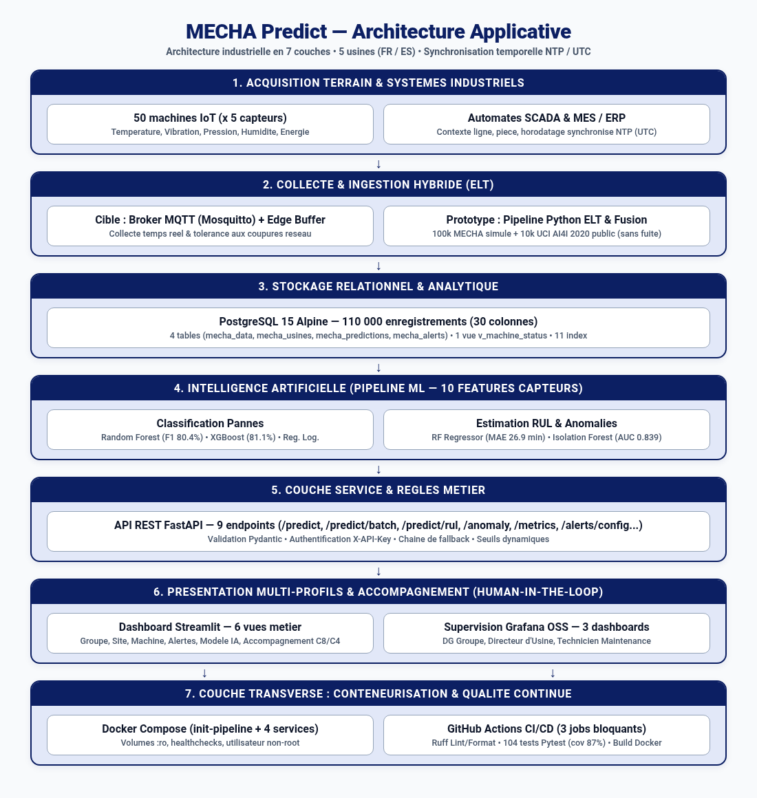
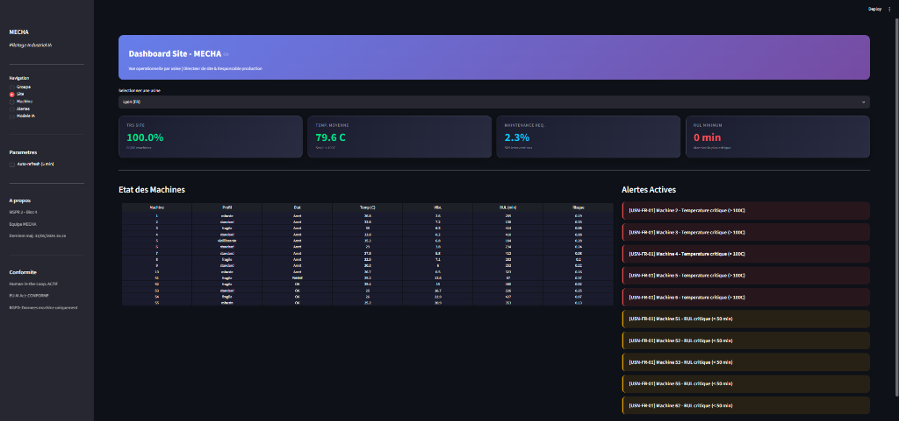
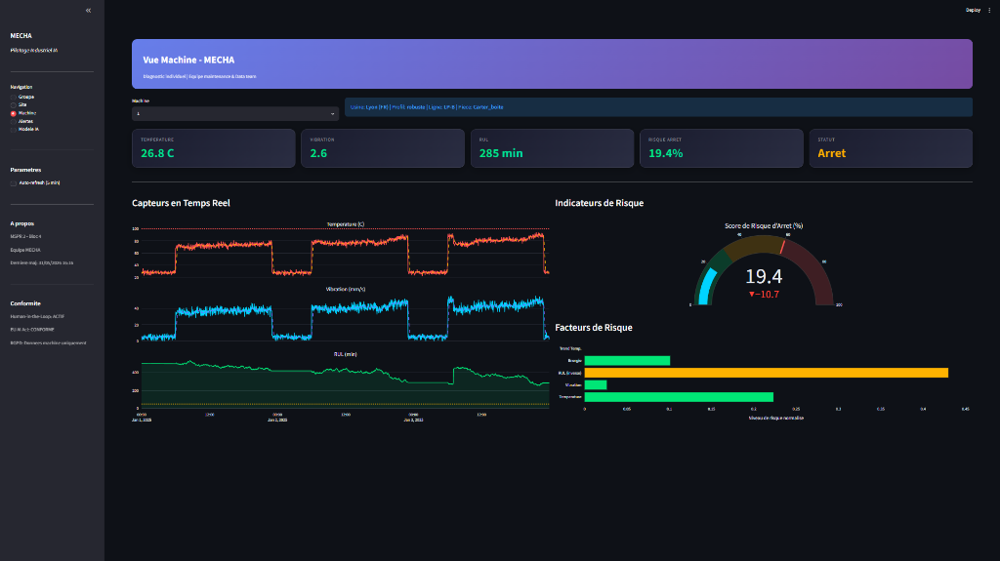
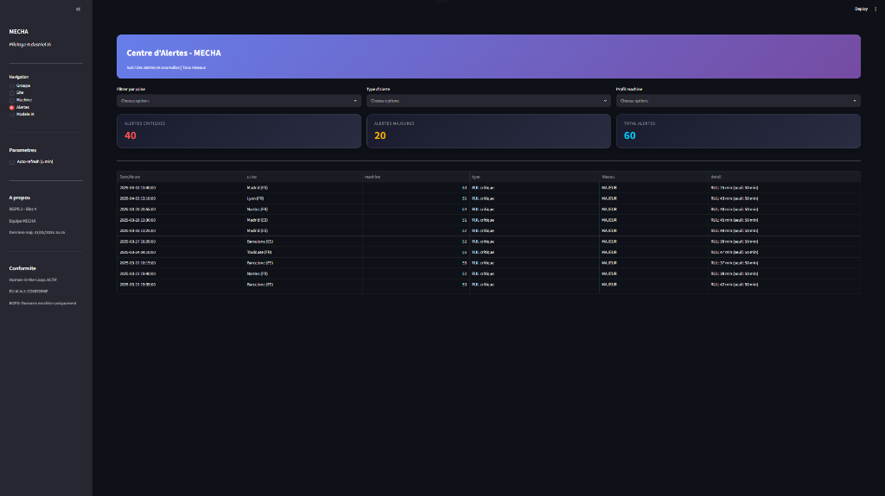
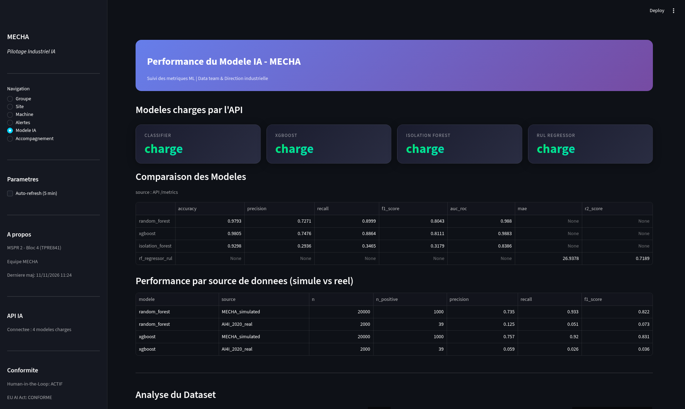
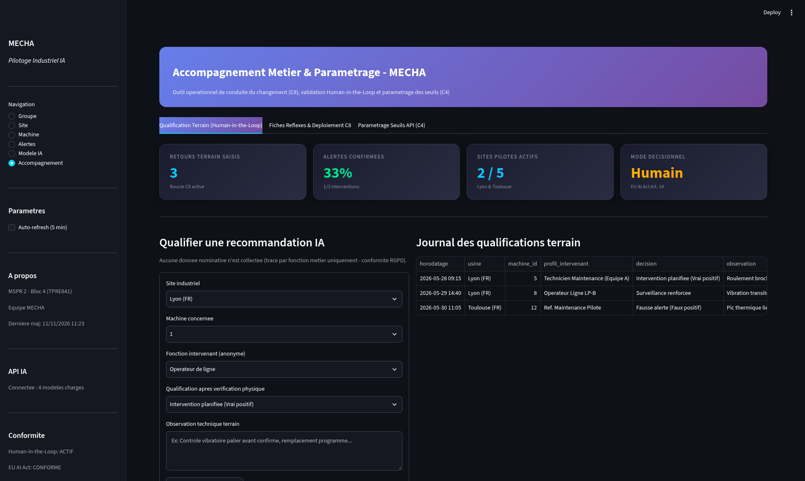
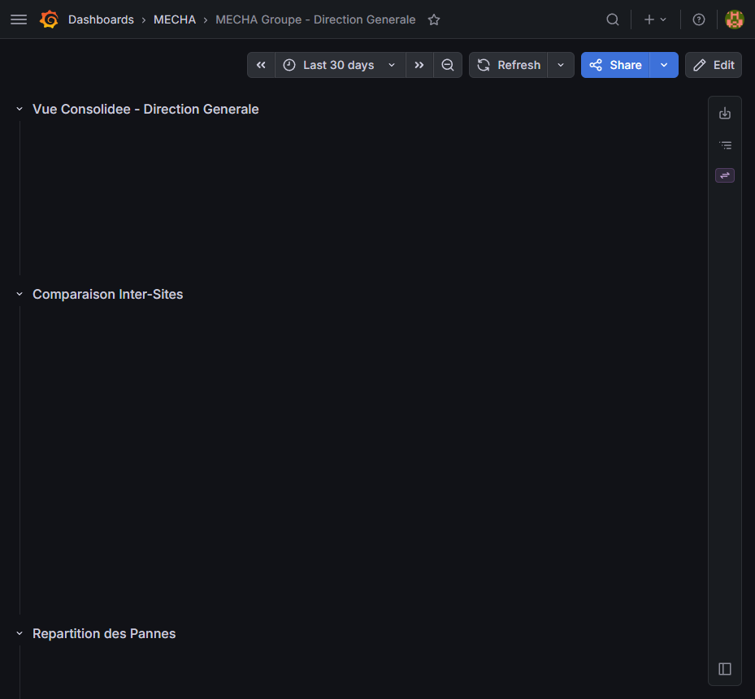
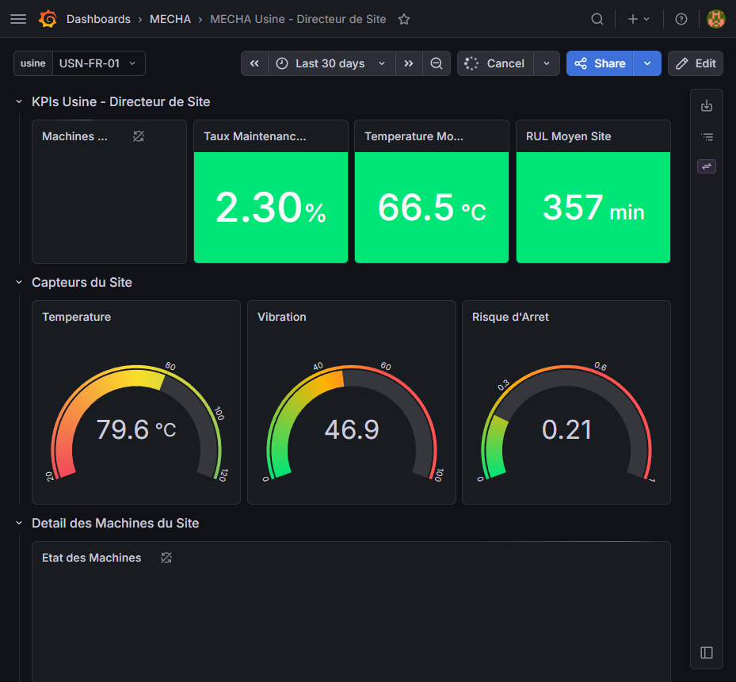
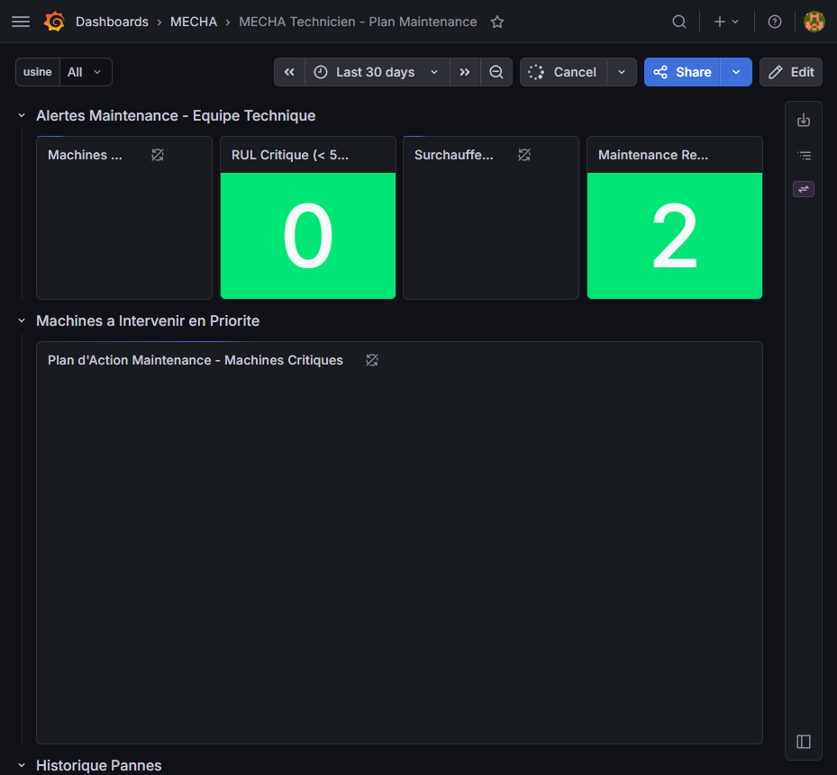

<p align="center">
  <h1 align="center">MECHA Predict — Maintenance Prédictive Industrielle par IA</h1>
  <p align="center">
    <strong>Plateforme intégrée d'analyse prédictive, d'estimation RUL et de supervision multi-sites</strong>
  </p>
  <p align="center">
    <a href="https://github.com/HASHT85/MSPR2-MECHA/actions/workflows/ci.yml">
      
    </a>
    
    
    
    
    
    
    
  </p>
</p>

---

## Contexte et Cadre Académique

**MECHA** est un groupe industriel européen fictif spécialisé dans l'usinage de haute précision (aéronautique 60 %, automobile 40 %), opérant **5 usines** en France (*Lyon, Toulouse, Nantes*) et en Espagne (*Barcelone, Madrid*). Ce projet industrialise le Proof of Concept initié lors de la **MSPR TPRE831** en livrant une plateforme complète de **maintenance prédictive par Intelligence Artificielle** permettant d'anticiper les défaillances, d'estimer la durée de vie résiduelle (*RUL*), d'unifier les alertes multi-sites et d'accompagner les équipes terrain (*Human-in-the-Loop*).

> **Certification** : RNCP35584 (Niveau 7) — *Expert en Informatique et Système d'Information* (EPSI)  
> **Épreuve** : MSPR **TPRE841** — Bloc 4 : *Concevoir et développer des solutions applicatives métier et spécifiques* (`C1` à `C8`)  
> **Équipe projet** : Malek El Fayedh, Thibaut Doreau, Vincent Gonçalves, Pierre-Louis Guinel

---

## Architecture Applicative

<p align="center">
  
</p>

| Service | Technologie | Port | Rôle dans l'architecture |
|---------|------------|:----:|--------------------------|
| **init-pipeline** | Python 3.11 (one-shot) | — | Génère automatiquement le dataset hybride (110k lignes) et entraîne les 5 modèles `.joblib` au premier lancement si absents |
| **db** | PostgreSQL 15 Alpine | `5432` | Stockage relationnel (`mecha_data`, `mecha_usines`, `mecha_predictions`, `mecha_alerts`), vue temps réel `v_machine_status`, 11 index |
| **api** | FastAPI + Pydantic | `8000` | API REST d'inférence ML et de règles métiers (**9 endpoints**, chaîne de fallback, clé API optionnelle) |
| **dashboard** | Streamlit + Plotly | `8501` | Application métier multi-profils (**6 vues** dont l'outil d'accompagnement terrain `C8` et le paramétrage dynamique `C4`) |
| **grafana** | Grafana OSS | `3000` | Supervision industrielle temps réel (**3 dashboards** provisionnés automatiquement par rôle) |

---

## Aperçu Visuel des Interfaces

### Dashboard Métier Streamlit (6 vues — Analyse IA & Accompagnement)

#### Vue Site — Directeur d'Usine
<p align="center">
  
</p>

#### Vue Machine — Diagnostic Individuel & RUL
<p align="center">
  
</p>

#### Centre d'Alertes Unifié
<p align="center">
  
</p>

#### Performance et Explicabilité du Modèle IA (sans fuite de données)
<p align="center">
  
</p>

#### Accompagnement Utilisateurs & Paramétrage Métier (C8 & C4)
<p align="center">
  
</p>

### Supervision Temps Réel Grafana (3 dashboards par rôle)

#### Direction Générale (DG Groupe)
<p align="center">
  
</p>

#### Directeur d'Usine
<p align="center">
  
</p>

#### Technicien Maintenance
<p align="center">
  
</p>

---

## Modèles de Machine Learning & Données

### Conformité des données (Sujet TPRE841 p.4)
Le jeu de données final (`110 000 lignes × 30 colonnes`) combine :
1. **100 000 mesures simulées MECHA** (`50 machines`, `5 usines`, cycles jour/nuit, dégradation physique progressive, 4 profils machines) ;
2. **10 000 mesures publiques communautaires de référence** issues du benchmark académique ouvert **UCI AI4I 2020 Predictive Maintenance Dataset** (*CC BY 4.0*, aucune donnée industrielle confidentielle réelle d'entreprise).

### Résultats évalués sur jeu de test temporel (22 000 lignes)

| Modèle | Type | F1-Score | Rappel | AUC-ROC / R² | Rôle opérationnel |
|--------|------|:--------:|:------:|:------------:|-------------------|
| **Random Forest** | Classification binaire | **80.4 %** | **90.0 %** | AUC = **0.988** | Modèle principal en production (`POST /predict`) |
| **XGBoost** | Classification binaire | **81.1 %** | 88.6 % | AUC = **0.988** | Modèle challenger / fallback automatique |
| **Régression Logistique** | Classification linéaire | 23.3 % | 92.0 % | AUC = 0.895 | Baseline linéaire de comparaison |
| **Isolation Forest** | Détection d'anomalies | 31.8 % | 34.7 % | AUC = 0.839 | Détection non supervisée (`POST /anomaly`) |
| **RF Regressor (RUL)** | Régression | MAE = **26.9 min** | RMSE = 46.4 min | **R² = 0.719** | Estimation durée de vie restante (`POST /predict/rul`) |

### Garanties méthodologiques
- **Zéro fuite de données (*Data Leakage*)** : entraînement strict sur **10 variables capteurs et temporelles** (`machine_status`, `predicted_remaining_life` et `downtime_risk` sont exclus et vérifiés par tests unitaires).
- **Split temporel 80/20 stratifié par source** : séparation chronologique stricte passé → futur sur chaque source, avec ventilation transparente des métriques (simulé vs benchmark UCI AI4I).
- **Gestion du déséquilibre de classes (4,7 % de pannes)** : `class_weight='balanced'` et `scale_pos_weight`.
- **Explicabilité et conformité EU AI Act** : 5 *Model Cards* détaillées dans `models/model_cards/` et validation *Human-in-the-Loop*.

---

## Démarrage Rapide

### Option 1 — Déploiement complet via Docker Compose (recommandé)

```bash
# 1. Cloner le dépôt
git clone https://github.com/HASHT85/MSPR2-MECHA.git
cd MSPR2-MECHA

# 2. Configurer les variables d'environnement
cp .env.example .env

# 3. Construire et démarrer toute la plateforme
# Le conteneur init-pipeline génère automatiquement le dataset 110k et les 5 modèles s'ils sont absents
docker compose up --build -d

# 4. Vérifier l'état des services (healthy)
docker compose ps
```

| Service | URL locale | Identifiants par défaut |
|---------|------------|-------------------------|
| **Dashboard Streamlit (6 vues)** | `http://localhost:8501` | Accès direct |
| **API FastAPI (Swagger OpenAPI)** | `http://localhost:8000/docs` | Header `X-API-Key` si activé |
| **Supervision Grafana (3 vues)** | `http://localhost:3000` | `admin` / défini dans `.env` |

### Option 2 — Exécution locale Python (pipeline reproductible)

```bash
python -m venv .venv && source .venv/bin/activate
pip install -r requirements.txt -r api/requirements.txt -r app/requirements.txt

# Régénération complète des données et des 5 modèles (~12 secondes)
python data/scripts/generate_data.py      # 100 000 lignes simulées MECHA
python data/scripts/merge_datasets.py     # Fusion 110 000 lignes (typage Int64 compatible PostgreSQL COPY)
python models/training/train_models.py    # Entraînement des 5 modèles compressés + métriques JSON
```

---

## Endpoints de l'API REST (`api/main.py`)

| Méthode | Route | Description |
|:-------:|-------|-------------|
| `GET` | `/health` | État de santé de l'API, disponibilité des modèles ML et uptime |
| `POST` | `/predict` | Prédiction unitaire de panne + niveau de risque + alertes de seuils |
| `POST` | `/predict/batch` | Prédiction par lot (jusqu'à 100 machines simultanées) |
| `POST` | `/predict/rul` | Estimation de la durée de vie résiduelle (*RUL* en minutes + catégorie d'urgence) |
| `POST` | `/anomaly` | Détection d'anomalie comportementale (*Isolation Forest* + facteurs contributifs) |
| `GET` | `/metrics` | Métriques d'évaluation des 5 modèles (ventilées par source) + télémétrie API |
| `GET` | `/model-info` | Fiches synthétiques des modèles chargés et statut de conformité EU AI Act |
| `GET` | `/alerts/config` | Consultation des seuils d'alerte métiers actifs |
| `PUT` | `/alerts/config` | Mise à jour dynamique à chaud des seuils d'alerte métiers |

---

## Qualité du Code, Tests & CI/CD

```bash
# Vérification du style et formatage (Ruff)
ruff check . && ruff format --check .

# Exécution des 104 tests automatisés avec couverture
MODEL_PATH=models/saved_models pytest --cov=api --cov=models --cov-report=term-missing -v
```

**104 tests automatisés (`100 % PASS`, `0 skipped`)** :
- `tests/test_data_quality.py` (**21 tests**) : structure 110k lignes, intégrité, absence de fuite de données, compatibilité stricte `\COPY` PostgreSQL sur les colonnes entières.
- `tests/test_model.py` (**16 tests**) : chargement des 5 modèles `.joblib`, cohérence des 10 features entraînement ↔ API, inférence réelle hors mode mock.
- `api/tests/test_api.py` (**61 tests**) : validation Pydantic des 9 routes REST, authentification `X-API-Key`, cas limites, modification dynamique des seuils (`87 %` de couverture sur `api/main.py`).
- `tests/test_integration.py` (**6 tests**) : scénarios métiers bout-en-bout (machine nominale vs critique, cohérence unitaire/batch, chaîne complète).

---

## Livrables Documentaires et Exports PDF Prêts à Déposer

Tous les livrables exigés par le sujet **MSPR TPRE841** sont regroupés dans le dossier racine [`livrables/`](livrables/) (ainsi qu'en version source Markdown dans `docs/`) :

| Livrable | Source Markdown | Fichier final prêt à déposer (`livrables/`) | Compétences |
|----------|-----------------|---------------------------------------------|:-----------:|
| **Dossier Global Consolidé** | [`docs/compte_rendu_soutenance.md`](docs/compte_rendu_soutenance.md) | [`livrables/01_Dossier_Global/00_Compte_Rendu_Global_MSPR_TPRE841_MECHA.pdf`](livrables/01_Dossier_Global/00_Compte_Rendu_Global_MSPR_TPRE841_MECHA.pdf) | **C1 à C8** |
| **Support de Soutenance (20 min)** | [`docs/soutenance.md`](docs/soutenance.md) | [`livrables/03_Support_Soutenance/Support_Soutenance_MECHA_TPRE841.pptx`](livrables/03_Support_Soutenance/Support_Soutenance_MECHA_TPRE841.pptx) & [`.pdf`](livrables/03_Support_Soutenance/Support_Soutenance_MECHA_TPRE841.pdf) | **Soutenance** |
| **01. Entretien Client & Besoins** | [`docs/client_interview.md`](docs/client_interview.md) | [`livrables/02_Documentation_et_Validation/01_Entretien_Client_Besoins_C1.pdf`](livrables/02_Documentation_et_Validation/01_Entretien_Client_Besoins_C1.pdf) | **C1** |
| **02. Architecture Applicative** | [`docs/architecture.md`](docs/architecture.md) | [`livrables/02_Documentation_et_Validation/02_Architecture_Applicative_C2.pdf`](livrables/02_Documentation_et_Validation/02_Architecture_Applicative_C2.pdf) | **C2, C4** |
| **03. Choix Techniques & Git** | [`docs/technical_choices.md`](docs/technical_choices.md) | [`livrables/02_Documentation_et_Validation/03_Choix_Techniques_et_Modeles_C2_C3.pdf`](livrables/02_Documentation_et_Validation/03_Choix_Techniques_et_Modeles_C2_C3.pdf) | **C2, C3** |
| **04. Dictionnaire de Données** | [`data/data_dictionary.md`](data/data_dictionary.md) | [`livrables/02_Documentation_et_Validation/04_Dictionnaire_Donnees_MECHA.pdf`](livrables/02_Documentation_et_Validation/04_Dictionnaire_Donnees_MECHA.pdf) | **C3, C4** |
| **05. Fiches Modèles (Model Cards)** | [`models/model_cards/`](models/model_cards/) | [`livrables/02_Documentation_et_Validation/05_Fiches_Modeles_ML_Model_Cards_C3.pdf`](livrables/02_Documentation_et_Validation/05_Fiches_Modeles_ML_Model_Cards_C3.pdf) | **C3, C7** |
| **06. Plan de Tests & Conformité** | [`docs/validation_plan.md`](docs/validation_plan.md) | [`livrables/02_Documentation_et_Validation/06_Plan_Tests_Validation_et_Conformite_C5_C7.pdf`](livrables/02_Documentation_et_Validation/06_Plan_Tests_Validation_et_Conformite_C5_C7.pdf) | **C5, C6, C7** |
| **07. Guide Utilisateur Métier (2 p.)** | [`docs/user_guide.md`](docs/user_guide.md) | [`livrables/02_Documentation_et_Validation/07_Guide_Utilisateur_Metier_2pages_C7.pdf`](livrables/02_Documentation_et_Validation/07_Guide_Utilisateur_Metier_2pages_C7.pdf) | **C7** |
| **08. Conduite du Changement** | [`docs/change_management.md`](docs/change_management.md) | [`livrables/02_Documentation_et_Validation/08_Conduite_du_Changement_C8.pdf`](livrables/02_Documentation_et_Validation/08_Conduite_du_Changement_C8.pdf) | **C8** |
| **09. Analyse RGPD & EU AI Act** | [`docs/rgpd_analysis.md`](docs/rgpd_analysis.md) | [`livrables/02_Documentation_et_Validation/09_Analyse_RGPD_et_EU_AI_Act.pdf`](livrables/02_Documentation_et_Validation/09_Analyse_RGPD_et_EU_AI_Act.pdf) | **C2, C7** |
| **10. Plan de Déploiement Multi-Sites** | [`docs/deployment_plan.md`](docs/deployment_plan.md) | [`livrables/02_Documentation_et_Validation/10_Plan_Deploiement_Multi_Sites.pdf`](livrables/02_Documentation_et_Validation/10_Plan_Deploiement_Multi_Sites.pdf) | **C4, C8** |
| **11. Modélisation BPMN 2.0 (AS-IS / TO-BE)** | [`docs/bpmn_processus_metiers.md`](docs/bpmn_processus_metiers.md) & [`docs/bpmn/`](docs/bpmn/) | [`livrables/02_Documentation_et_Validation/11_Modelisation_Processus_BPMN_AS_IS_TO_BE_C1_C8.pdf`](livrables/02_Documentation_et_Validation/11_Modelisation_Processus_BPMN_AS_IS_TO_BE_C1_C8.pdf) | **C1, C4, C8** |

---

## Structure du Dépôt

```text
MSPR2-MECHA/
├── livrables/                  # Dossier prêt à rendre au jury (PDF A4 paginés & support PowerPoint)
│   ├── 01_Dossier_Global/      # Compte-rendu maître consolidé (C1 à C8, incluant les BPMN)
│   ├── 02_Documentation_et_Validation/ # 11 dossiers thématiques PDF (dont Guide Métier 2p & BPMN 2.0)
│   └── 03_Support_Soutenance/  # Diaporama de soutenance 16:9 (.pptx et .pdf)
├── api/                        # API REST FastAPI (main.py : 9 routes, Dockerfile non-root, 61 tests)
├── app/                        # Dashboard métier Streamlit (dashboard.py : 6 vues, Dockerfile)
├── data/                       # Pipeline de données (generate_data.py, merge_datasets.py, data_dictionary.md)
├── db/                         # Base PostgreSQL 15 (init.sql : 4 tables + vue + 11 index, load_data.sh)
├── docs/                       # Sources Markdown (.md), schémas BPMN 2.0 XML (bpmn/) et visuels (images/)
├── grafana/                    # Provisioning YAML automatique + 3 dashboards JSON par rôle métier
├── models/                     # Entraînement ML (train_models.py), 5 Model Cards, métriques JSON
├── scripts/                    # Scripts de lancement/arrêt 1-clic pour la démo locale (Windows/macOS/Linux)
├── tests/                      # Suites de tests transverses (qualité données, modèles ML, intégration)
├── .github/workflows/ci.yml    # Pipeline CI/CD GitHub Actions (Lint Ruff -> Data/ML/104 Tests -> Build Docker)
├── docker-compose.yml          # Orchestration reproductible (init-pipeline + db + api + dashboard + grafana)
├── requirements.txt            # Dépendances Python globales
└── ruff.toml                   # Configuration standardisée du linter et formateur Python
```
