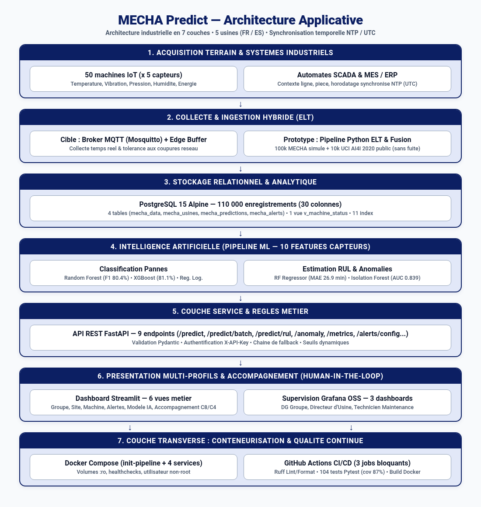
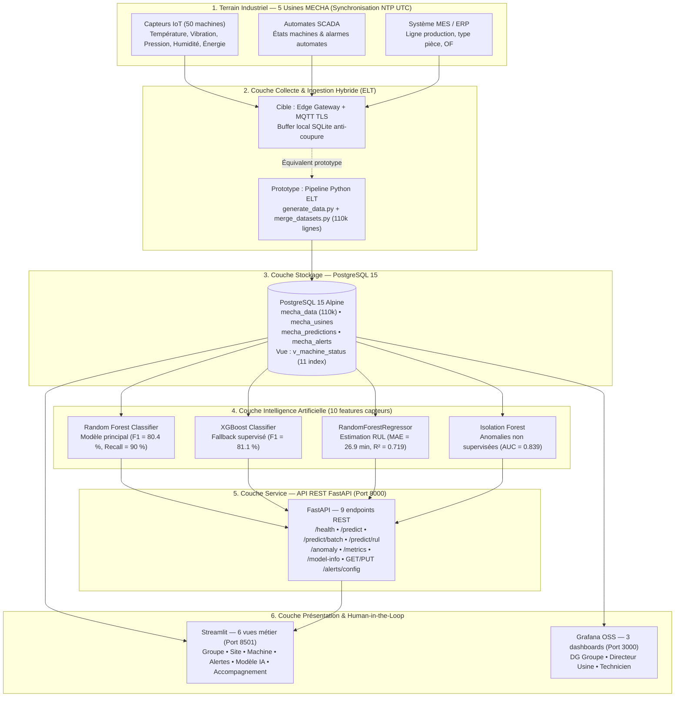
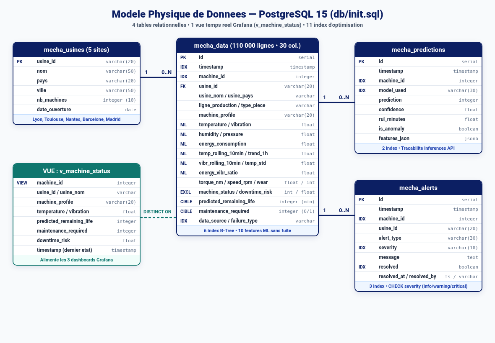
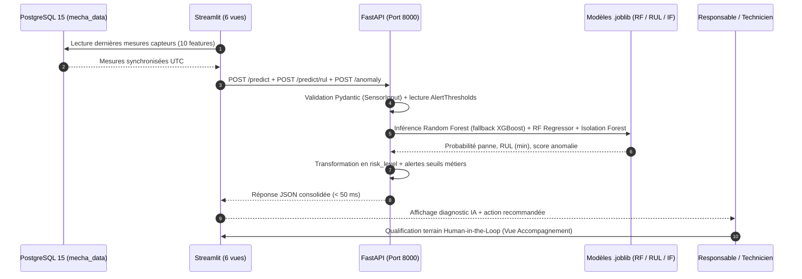

# Architecture Technique et Intégration Applicative — MECHA Predict

> **Projet** : MECHA Predict — Maintenance Prédictive Industrielle par IA  
> **Certification** : RNCP35584 — Expert en Informatique et Système d'Information (Bloc 4 — MSPR TPRE841, suite de TPRE831)  
> **Version** : 2.0  
> **Date** : Mai 2026  
> **Auteurs** : Malek El Fayedh, Thibaut Doreau, Vincent Gonçalves, Pierre-Louis Guinel  
> **Compétences couvertes** : **C2 — Concevoir une architecture applicative** & **C4 — Développer une solution applicative intégrée**

---

## 1. Introduction et Objectifs Architecturaux

Ce document formalise l'architecture applicative, matérielle, logicielle et fonctionnelle de **MECHA Predict**, plateforme de maintenance prédictive destinée aux **5 usines européennes** du groupe MECHA (*Lyon, Toulouse, Nantes, Barcelone, Madrid* — **50 machines MECHA** en cible industrielle, complétées dans le prototype par 50 machines de référence issues du jeu public UCI AI4I 2020).

Dans la continuité du cadrage réalisé en **MSPR TPRE831**, l'architecture vise à éliminer le silotage entre les systèmes **SCADA**, **MES** et **ERP**, tout en garantissant la **stabilité**, l'**efficacité**, la **pérennité** et la **tolérance aux pannes** exigées en environnement industriel critique (aéronautique EN 9100 et automobile IATF 16949).

| Objectif | Traduction architecturale | Exigence métier associée |
|----------|--------------------------|--------------------------|
| **Collecte multi-sources synchronisée** | Acquisition capteurs IoT + contexte SCADA/MES horodatés en UTC via NTP | Vision unifiée des 5 sites (BF-01, BF-05) |
| **Stockage relationnel structuré** | PostgreSQL 15 ACID avec indexation B-Tree et vue temps réel `v_machine_status` | Disponibilité >= 99,5 %, traçabilité EN 9100 (BNF-01, BNF-04) |
| **Inférence IA sans fuite de données** | Pipeline scikit-learn / XGBoost isolé sur 10 variables capteurs et exposé par API | Anticipation des pannes et RUL fiable (BF-03, BF-06) |
| **Restitution bi-modale par profil** | Grafana OSS (temps réel atelier/DG) + Streamlit 6 vues (diagnostic IA & accompagnement C8) | Temps de réponse < 3 s, ergonomie métier (BNF-02, BNF-07) |
| **Déploiement reproductible et CI/CD** | Docker Compose (`init-pipeline` + 4 services) et GitHub Actions (3 jobs bloquants) | Industrialisation multi-sites France/Espagne (BNF-05) |

---

## 2. Vue d'Ensemble de l'Architecture en 7 Couches

> **Distinction transparente entre architecture cible industrielle et prototype livré (`docker compose up`)** :  
> - **En cible industrielle multi-sites** : chaque usine dispose d'une passerelle *Edge Gateway* collectant les automates **SCADA** (Modbus TCP / OPC-UA) et le contexte de fabrication **MES** (ligne, référence pièce, ordre de fabrication), puis publiant les télémétries sur un broker **MQTT TLS (Mosquitto)** avec tampon local SQLite en cas de coupure VPN.  
> - **Dans le prototype fonctionnel livré (MSPR TPRE841)** : le conteneur d'initialisation `init-pipeline` génère et fusionne de manière reproductible les **110 000 enregistrements** (`data/processed/mecha_dataset_processed.csv`), le script `db/load_data.sh` les ingère dans **PostgreSQL 15**, et les couches **Stockage, Intelligence, Service API (9 routes), Présentation (Streamlit 6 vues + Grafana 3 dashboards) et CI/CD** sont 100 % opérationnelles et testées automatiquement (**104 tests passants**).

---

## 3. Description Détaillée des Couches et Synchronisation Multi-Sources

### 3.1 Couches Acquisition & Ingestion : Intégration SCADA, MES et Synchronisation Temporelle

Le sujet MSPR TPRE841 souligne la dispersion initiale des données entre **capteurs IoT**, **SCADA** et **MES**, ainsi que la nécessité d'une **synchronisation temporelle rigoureuse** entre les 5 usines (France et Espagne) :

| Source industrielle | Données produites | Protocole cible | Règle de synchronisation temporelle |
|---------------------|-------------------|-----------------|-------------------------------------|
| **Capteurs IoT (x5/machine)** | `temperature`, `vibration`, `humidity`, `pressure`, `energy_consumption` | Modbus TCP / MQTT QoS 1 | Horodatage **UTC ISO 8601** à la source via serveur **NTP stratum 2** local sur chaque *Edge Gateway* (dérive < 10 ms) |
| **SCADA atelier** | `machine_status`, codes défauts automates (`failure_type`), arrêts d'urgence | OPC-UA -> Passerelle Python | Alignement par fenêtre glissante de **1 minute** (`resample('1min')`) avant calcul des indicateurs glissants (`temp_rolling_10min`, `temp_trend_1h`) |
| **MES / GPAO** | `usine_id`, `ligne_production`, `type_piece`, `machine_profile` | Vue SQL / API REST interne | Jointure contextuelle déterministe sur `(machine_id, timestamp)` lors de l'étape ELT |

> **Conformité de l'étape `COPY` PostgreSQL** : dans `data/scripts/merge_datasets.py`, les colonnes entières (`rotational_speed_rpm`, `tool_wear_min`, `machine_id`, `machine_status`, `anomaly_flag`, `predicted_remaining_life`, `maintenance_required`) sont typées en entiers nullables pandas `"Int64"` avant export CSV afin d'éviter toute sérialisation flottante (`"2636.0"`) lors du chargement massif `\COPY` dans PostgreSQL.

### 3.2 Couche Stockage — Modèle Physique PostgreSQL 15 (`db/init.sql`)

Le schéma physique exécuté automatiquement au démarrage du conteneur `mecha-postgres` (`postgres:15-alpine`) repose sur **4 tables**, **1 vue temps réel** et **11 index B-Tree** :

1. **`mecha_usines`** : référentiel des 5 sites industriels (`USN-FR-01` à `USN-ES-02`, 10 machines de référence par site).
2. **`mecha_data`** : table centrale des télémétries et features enrichies (**110 000 lignes, 30 colonnes métier** + `id`, `created_at`), indexée sur `timestamp`, `machine_id`, `usine_id`, `maintenance_required`, `machine_status` et `data_source`.
3. **`mecha_predictions`** : journal d'audit des inférences ML (`model_used`, `prediction`, `confidence`, `rul_minutes`, `is_anomaly`, `features_json` en `JSONB`) répondant aux exigences de traçabilité aéronautique EN 9100 et EU AI Act.
4. **`mecha_alerts`** : cycle de vie des alertes opérationnelles (`severity` contrainte par `CHECK ('info', 'warning', 'critical')`, `resolved`, `resolved_at`, `resolved_by`).
5. **`v_machine_status` (Vue SQL)** : requête `SELECT DISTINCT ON (machine_id) ... ORDER BY machine_id, timestamp DESC` exposant instantanément le dernier état connu de chaque machine aux 3 tableaux de bord Grafana sans duplication de données.

### 3.3 Couche Intelligence Artificielle — Pipeline ML sans Data Leakage

| Modèle (`models/saved_models/`) | Algorithme | Sortie produite | Performance test (22k lignes) |
|---------------------------------|------------|-----------------|-------------------------------|
| `random_forest_classifier.joblib` | `RandomForestClassifier` (`class_weight='balanced'`) | Probabilité de panne `[0, 1]` + classe `{0, 1}` | **F1 = 80.4 %**, Recall = **90.0 %**, AUC = **0.988** |
| `xgboost_classifier.joblib` | `XGBClassifier` (`scale_pos_weight`) | Probabilité de panne (modèle de secours) | **F1 = 81.1 %**, Recall = **88.6 %**, AUC = **0.988** |
| `rf_regressor_rul.joblib` | `RandomForestRegressor` | Durée de vie résiduelle `rul_minutes` (`0–500 min`) | **MAE = 26.9 min**, RMSE = 46.4 min, **R² = 0.719** |
| `isolation_forest.joblib` | `IsolationForest` + `StandardScaler` | Score d'anomalie non supervisé | **AUC = 0.839**, Accuracy = 93.0 % |
| `logistic_regression.joblib` | `LogisticRegression` + `StandardScaler` | Baseline linéaire académique | F1 = 23.3 %, Recall = 92.0 %, AUC = 0.895 |

Les modèles sont sérialisés avec compression (`joblib.dump(..., compress=3)`, **32 Mo au total**) et n'acceptent **que les 10 features capteurs et temporelles** (`temperature`, `vibration`, `humidity`, `pressure`, `energy_consumption`, `temp_rolling_10min`, `temp_trend_1h`, `vibr_rolling_10min`, `temp_std_30min`, `energy_vibr_ratio`).

### 3.4 Couche Service — API REST FastAPI (`api/main.py`)

L'API centrale découple totalement la logique d'inférence IA des interfaces de visualisation. Elle expose **9 routes REST** documentées en OpenAPI :

| Endpoint | Méthode | Entrée Pydantic | Sortie & Rôle fonctionnel |
|----------|:-------:|-----------------|---------------------------|
| `/health` | `GET` | — | Statut de l'API, booléen `models_loaded`, liste des modèles chargés, uptime |
| `/predict` | `POST` | `SensorInput` (10 capteurs) | Probabilité de panne, `risk_level`, alertes de seuils, modèle utilisé |
| `/predict/batch` | `POST` | `BatchInput` (1 à 100 machines) | Inférence vectorisée pour la vue Site et le Centre d'Alertes |
| `/predict/rul` | `POST` | `SensorInput` | `rul_minutes`, catégorie (`urgent`, `soon`, `moderate`, `safe`), action recommandée |
| `/anomaly` | `POST` | `SensorInput` | Détection *Isolation Forest*, score normalisé, sévérité et facteurs contributifs |
| `/metrics` | `GET` | — | Métriques réelles d'entraînement (`all_models_metrics.json`) ventilées par source + compteur d'appels |
| `/model-info` | `GET` | — | Métadonnées des modèles et conformité EU AI Act (*Human-in-the-Loop*) |
| `/alerts/config` | `GET` | — | Lecture de la configuration active des seuils métiers (`AlertThresholds`) |
| `/alerts/config` | `PUT` | `AlertThresholds` | Mise à jour dynamique des seuils critiques/warnings sans redémarrage |

### 3.5 Couche Présentation — Complémentarité Grafana (3 dashboards) & Streamlit (6 vues)

- **Grafana OSS (Port 3000)** : interroge directement PostgreSQL (`v_machine_status` et `mecha_data`) pour la supervision temps réel par rôle (**DG Groupe**, **Directeur d'Usine**, **Technicien Maintenance**).
- **Streamlit (Port 8501)** : interroge l'API FastAPI pour toutes les inférences ML et propose **6 vues métier** : **Groupe**, **Site**, **Machine**, **Alertes**, **Modèle IA** et **Accompagnement** (qualification terrain *Human-in-the-Loop*, fiches réflexes par rôle et paramétrage dynamique des seuils API).

---

## 4. Justification selon les Critères d'Évaluation C2 : Stabilité, Efficacité, Pérennité et Tolérance aux Pannes

Conformément à la grille d'évaluation certificative **C2**, l'architecture MECHA Predict garantit formellement les quatre propriétés suivantes :

| Propriété C2 | Mécanismes architecturaux implémentés dans MECHA Predict | Preuve vérifiable dans le dépôt |
|--------------|----------------------------------------------------------|---------------------------------|
| **1. Stabilité** | - Conteneurisation isolée avec versions figées (`python:3.11-slim`, `postgres:15-alpine`, `grafana:11.6.0`) - Validation stricte des types et plages physiques par schémas **Pydantic** (`Field(ge=..., le=...)`) rejetant les entrées corrompues (`HTTP 422`) - Transactions **ACID** PostgreSQL et contraintes d'intégrité SQL | `docker-compose.yml`, `api/main.py` (`SensorInput`), `db/init.sql`, 61 tests API |
| **2. Efficacité** | - Inférence vectorisée par lot (`POST /predict/batch` traitant 100 machines en < 25 ms) - 11 index B-Tree PostgreSQL + vue `DISTINCT ON` (`v_machine_status`) évitant les scans complets sur 110k lignes - Cache applicatif `@st.cache_data(ttl=30)` limitant la charge réseau et CPU - Modèles compressés (`compress=3`, 32 Mo en RAM) | `api/main.py`, `db/init.sql`, `app/src/dashboard.py`, `models/training/train_models.py` |
| **3. Pérennité** | - Architecture **modulaire découplée** : le remplacement d'un modèle `.joblib` ou l'ajout de **TimescaleDB / MLflow / Kafka** n'impacte ni les contrats REST OpenAPI ni les dashboards - Technologies 100 % open-source matures sans *vendor lock-in* - Qualité garantie dans le temps par CI/CD bloquante (`ruff.toml` + 104 tests `pytest`) | `docs/technical_choices.md`, `.github/workflows/ci.yml`, `models/model_cards/*.md` |
| **4. Tolérance aux pannes & Mode dégradé** | - **Chaîne de triple fallback API** : `Random Forest` -> `XGBoost` -> heuristique physique déterministe (`mock`) si un fichier modèle est indisponible - **Résilience UI Streamlit** : si l'API ne répond pas, affichage d'un bandeau explicite `API HORS LIGNE` et repli gracieux sur les indicateurs historiques sans crash - **Healthchecks Docker** (`pg_isready`, `/docs`, `/_stcore/health`, `/api/health`) + `restart: unless-stopped` - **Cible usine** : buffer local SQLite sur *Edge Gateway* en cas de perte du tunnel VPN | `api/main.py` (`predict_with_fallback`), `app/src/dashboard.py`, `docker-compose.yml` |

---

## 5. Diagramme de Séquence — Flux d'Inférence, Règles Métiers et Human-in-the-Loop

---

## 6. Intégration Applicative, Paramétrage et Formalisme de Configuration (C4)

Pour répondre pleinement aux attendus de la compétence **C4** (*paramétrage d'outils logiciels et formalisme de configuration*), la solution s'appuie sur quatre mécanismes déclaratifs et dynamiques sans aucune valeur codée en dur non justifiable :

### 6.1 Provisioning déclaratif YAML de Grafana (`grafana/provisioning/`)
Au démarrage du conteneur `mecha-grafana`, la connexion PostgreSQL et les 3 dashboards métiers sont instanciés automatiquement par fichiers YAML versionnés :
- **`grafana/provisioning/datasources/datasource.yml`** : déclare la source `PostgreSQL MECHA` (`uid: mecha-postgres`, `url: db:5432`, injection sécurisée du secret `$__env{POSTGRES_PASSWORD}`, pool de 10 connexions, `postgresVersion: 1500`).
- **`grafana/provisioning/dashboards/dashboard.yml`** : monte automatiquement le dossier `/var/lib/grafana/dashboards` dans le répertoire logique `MECHA`.
- **`grafana/dashboards/*.json`** (`dg_groupe.json`, `directeur_usine.json`, `technicien.json`) : définissent en JSON les requêtes SQL paramétrées par variables Grafana (`$usine`), les seuils de jauges vert/orange/rouge et les fréquences de rafraîchissement.

### 6.2 Configuration par variables d'environnement (`.env` / `docker-compose.yml`)
Toute la topologie d'exécution est pilotée par variables d'environnement externalisées (`.env.example`) : `POSTGRES_DB`, `POSTGRES_USER`, `POSTGRES_PASSWORD`, `MODEL_PATH`, `PREDICTION_THRESHOLD` (`0.5`), `API_KEY`, `ALLOWED_ORIGINS`, `API_URL` (`http://api:8000`). Les volumes de données et de modèles sont montés en lecture seule (`:ro`) dans les conteneurs applicatifs.

### 6.3 Règles de transformation des scores IA et paramétrage dynamique (`GET/PUT /alerts/config`)
L'API transforme les sorties mathématiques brutes des modèles en indicateurs opérationnels actionnables et permet aux responsables maintenance d'ajuster les seuils à chaud (via `PUT /alerts/config` ou l'onglet **Accompagnement > Paramétrage Seuils API** du dashboard) :

| Variable / Score d'entrée | Règle de transformation / Seuil configurable | Sortie métier produite |
|---------------------------|----------------------------------------------|------------------------|
| Probabilité `Random Forest` `p` | `p < 0.30` -> `low` ; `0.30 <= p < 0.60` -> `medium` ; `0.60 <= p < 0.80` -> `high` ; `p >= 0.80` -> `critical` | Niveau de risque standardisé + code couleur |
| Durée résiduelle `rul_minutes` | `< 50 min` -> `urgent` ; `50–150 min` -> `soon` ; `150–300 min` -> `moderate` ; `>= 300 min` -> `safe` | Priorisation d'ordre de travail maintenance |
| Température / Vibration / Pression | Défaut : `temp > 85 °C` (warning) / `100 °C` (critical), `vibr > 50` / `70 mm/s`, `pressure < 1.5 bar` | Liste d'alertes physiques déterministes complémentaires au score ML |

---

## 7. Contraintes Réseau, Dimensionnement et Évolutivité

| Métrique / Composant | Phase Pilote (Lyon — 10 machines) | Déploiement Groupe (5 sites — 50 machines) | Évolution > 100 machines (18 mois) |
|----------------------|:---------------------------------:|:------------------------------------------:|:----------------------------------:|
| **Flux de mesures / jour** | ~864 000 | ~4 320 000 | > 15 000 000 (passage Kafka) |
| **Volume PostgreSQL / mois** | ~2 Go | ~10 Go | Extension **TimescaleDB** (hypertables) |
| **Serveur Central (API + ML)** | 4 vCPU / 16 Go RAM | 8 vCPU / 32 Go RAM / 500 Go SSD | Cluster **Kubernetes** + **MLflow** |
| **Edge Gateway par site** | 1 passerelle Linux (2 vCPU, 4 Go) | 5 passerelles + VPN WireGuard chiffré | Inférence Edge ONNX locale |

---

> **Document validé par** : Équipe projet MECHA — Mai 2026
