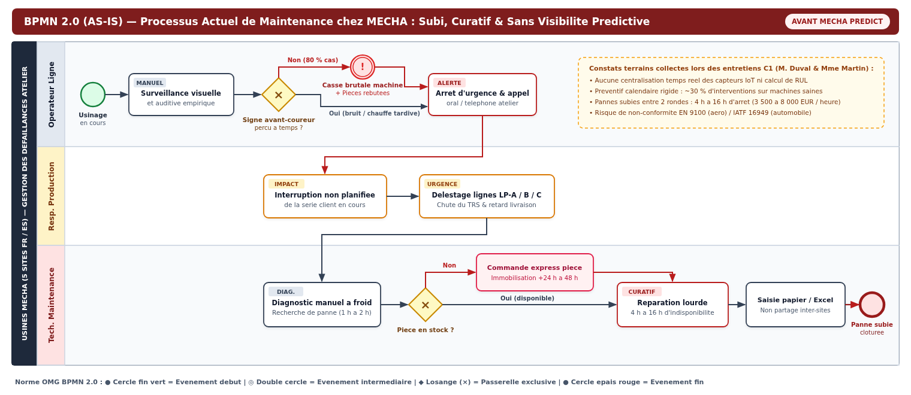
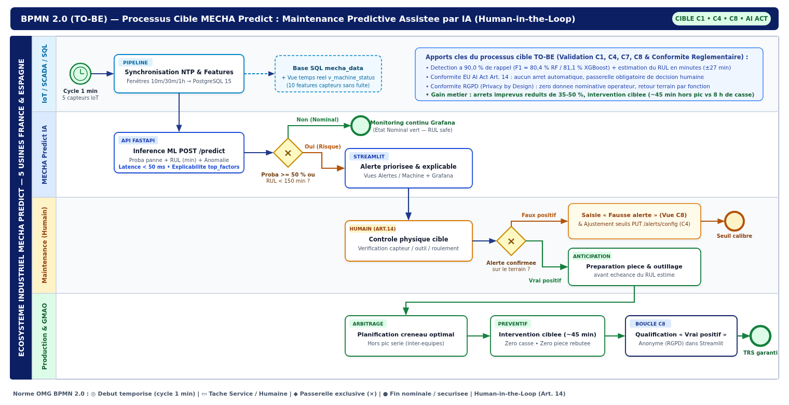

# Modélisation des Processus Métiers (Norme OMG BPMN 2.0 — AS-IS vs TO-BE)

> **Certification** : RNCP35584 (Niveau 7) — Bloc 4 : *Concevoir et développer des solutions applicatives métier et spécifiques*  
> **Référence** : MSPR TPRE841 — Compétences **C1** (Collecte & processus métiers), **C4** (Intégration applicative) & **C8** (Conduite du changement)  
> **Fichiers sources XML BPMN 2.0** : `docs/bpmn/01_mecha_maintenance_AS_IS.bpmn` et `docs/bpmn/02_mecha_maintenance_TO_BE.bpmn` *(compatibles Camunda / bpmn.io / Draw.io)*

---

## 1. Objectif et convention de modélisation BPMN 2.0

Afin de formaliser sans ambiguïté l'évolution organisationnelle induite par **MECHA Predict** sur les **5 sites industriels (Lyon, Toulouse, Nantes, Barcelone, Madrid)**, les workflows de maintenance ont été modélisés selon la norme internationale **OMG BPMN 2.0 (*Business Process Model and Notation*)** :

- **Piscines (*Pools*) et Couloirs (*Swimlanes*)** : séparation stricte des responsabilités entre l'atelier (*Opérateur de ligne*), la *Production*, la *Maintenance*, l'infrastructure *IoT/SCADA/SQL* et la plateforme *MECHA Predict*.
- **Événements normalisés** : cercle fin vert pour le déclenchement (manuel ou temporisé chaque minute), double cercle pour les événements intermédiaires d'exception, cercle épais pour les états de clôture.
- **Passerelles exclusives (`×`)** : matérialisation explicite des embranchements conditionnels (franchissement des seuils IA, validation humaine obligatoire **EU AI Act Art. 14**, disponibilité stock).

---

## 2. Processus Actuel `AS-IS` — Maintenance Subie et Préventif Calendaire Rigide

Lors des entretiens métiers menés en phase **C1** auprès de M. Jean-Pierre Duval (*Directeur Industriel Groupe*) et de Mme Sophie Martin (*Responsable Maintenance — Lyon*), trois dysfonctionnements majeurs ont été mis en évidence dans le processus historique (`70 %` curatif, `25 %` préventif calendaire systématique, `< 5 %` prédictif empirique) :

### Points de rupture identifiés sur le flux `AS-IS`
1. **Absence de détection précoce** : les dérives thermiques ou vibratoires lentes passent inaperçues entre deux rondes manuelles, conduisant dans ~80 % des cas à l'arrêt brutal en pleine série client et à la mise au rebut des pièces aéronautiques/automobiles en cours d'usinage.
2. **Désorganisation inter-services** : l'alerte circule oralement ou par téléphone sans contexte technique ; la Production subit l'arrêt imprévu et la Maintenance perd 1 h à 2 h en diagnostic à froid avant même d'identifier la pièce défaillante.
3. **Double pénalité financière** : immobilisation lourde de **4 h à 16 h** (jusqu'à **48 h** en cas de rupture de stock pièce, à raison de `3 500` à `8 000 EUR/h`), doublée d'environ **30 % d'interventions calendaires inutiles** sur des machines pourtant saines.
4. **Silos d'information** : les comptes-rendus papier ou Excel locaux ne sont ni consolidés entre la France et l'Espagne, ni exploitables pour auditer facilement les exigences **EN 9100** et **IATF 16949**.

---

## 3. Processus Cible `TO-BE` — Maintenance Prédictive Assistée par IA (*Human-in-the-Loop*)

Le processus cible intègre la plateforme **MECHA Predict** au cœur du flux opérationnel tout en préservant intégralement la décision finale de l'équipe métier :

### Mécanismes structurants du flux `TO-BE`
1. **Acquisition synchronisée et inférence temps réel (`< 50 ms`)** : chaque minute, les 5 capteurs physiques sont agrégés sur fenêtres glissantes (`10 min`, `30 min`, `1 h`), historisés dans PostgreSQL 15 (`mecha_data`) et évalués par l'API FastAPI (`POST /predict`) qui calcule simultanément la probabilité de défaillance (`Random Forest` / `XGBoost`, rappel **90,0 %**), le temps restant avant panne (**RUL en minutes**, `MAE = 27 min`) et le score d'anomalie (`Isolation Forest`).
2. **Passerelle obligatoire *Human-in-the-Loop* (Conformité EU AI Act Art. 14)** : **aucun ordre d'arrêt automatique n'est envoyé à l'automate machine**. Toute alerte (`Probabilité >= 50 %` ou `RUL < 150 min`) est présentée avec ses facteurs explicatifs (`top_factors`) au technicien qui effectue une levée de doute physique ciblée.
3. **Boucle d'amélioration continue C8 et paramétrage dynamique C4** :
   - En cas de **faux positif** (transitoire de nettoyage ou changement d'outil), l'intervenant qualifie l'alerte en 15 secondes dans la 6e vue Streamlit **Accompagnement** et le responsable peut ajuster les seuils à chaud via `PUT /alerts/config`.
   - En cas de **vrai positif confirmé**, la pièce détachée est préparée avant la panne et le créneau d'intervention (~**45 minutes**) est planifié avec le Responsable Production hors pic critique, sans casse ni rebut, avec traçabilité **100 % anonyme (conformité RGPD)**.

---

## 4. Synthèse comparative `AS-IS` vs `TO-BE`

| Dimension opérationnelle | Processus `AS-IS` (Avant IA) | Processus `TO-BE` (Avec MECHA Predict) | Gain / Impact métier |
| :--- | :--- | :--- | :--- |
| **Mode de déclenchement** | Panne subie (70 %) ou échéance calendaire fixe (25 %) | Détection prédictive continue (cycle 1 min, rappel **90,0 %**) | Anticipation moyenne de plusieurs heures (`RUL` en minutes) |
| **Diagnostic initial** | Manuel à froid sur machine arrêtée (`1 h` à `2 h`) | Pré-orienté par les facteurs explicatifs IA (`top_factors`) | Temps de diagnostic divisé par **3 à 4** |
| **Durée moyenne d'immobilisation** | `4 h` à `16 h` (`+24–48 h` si pièce absente) | ~`45 min` planifiées hors pic avec pièce préparée | **-35 % à -50 %** d'arrêts non planifiés visés à 12 mois |
| **Impact Production & Qualité** | Interruption de lot, rebuts matière, risque pénalités | Arbitrage concerté Maintenance / Production avant casse | **TRS préservé** (cible >= 93 %) et baisse des rebuts |
| **Gouvernance & Conformité** | Fiches papier/Excel dispersées par usine | PostgreSQL centralisé + *Human-in-the-Loop* + anonymat RGPD | Conformité **EN 9100**, **IATF 16949**, **RGPD** & **EU AI Act** |
