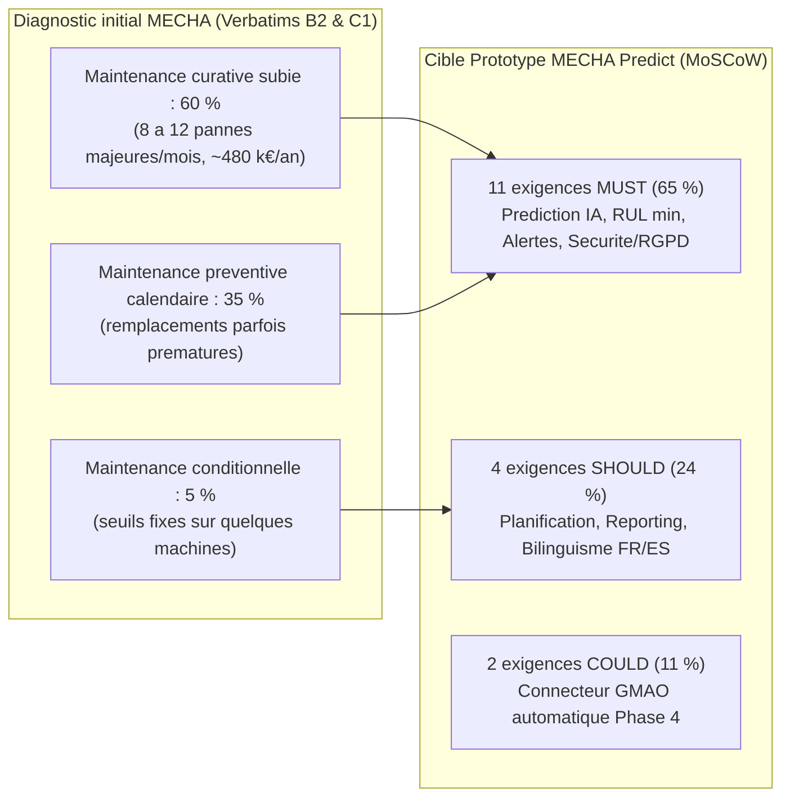
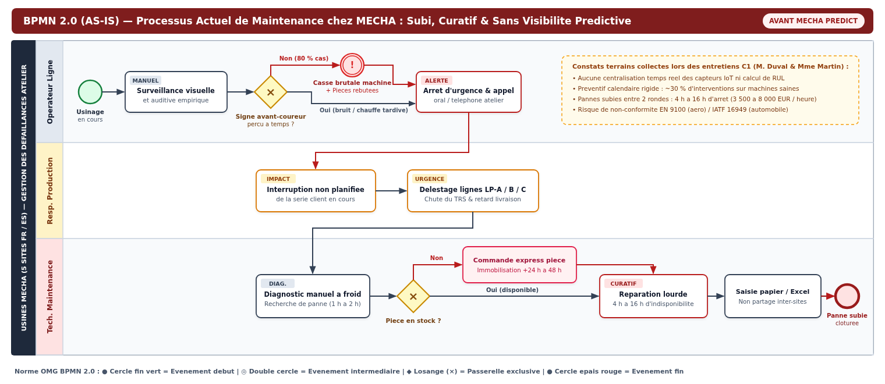

# 🎤 Compte-Rendu d'Entretien Client — MECHA Predict

> **Projet** : MECHA — Maintenance Prédictive par Intelligence Artificielle  
> **Version** : 1.0  
> **Date** : 30/05/2026  
> **Compétence couverte** : **C1 — Collecter les besoins métiers**

---

## 1. Informations de l'entretien

| Champ | Détail |
|-------|--------|
| **Date** | 15 avril 2026 |
| **Heure** | 14h00 — 16h30 (2h30) |
| **Lieu** | Siège MECHA, Lyon (salle de réunion « Innovation ») |
| **Type** | Entretien semi-directif, en présentiel |

### Participants

**Côté client (Direction Industrielle MECHA)** :

| Nom | Fonction | Rôle dans l'entretien |
|-----|----------|----------------------|
| M. Jean-Pierre Duval | Directeur Industriel | Commanditaire, vision stratégique |
| Mme Sophie Martin | Responsable Maintenance — site de Lyon | Expertise terrain, processus actuels |

**Côté équipe projet** :

| Nom | Fonction | Rôle dans l'entretien |
|-----|----------|----------------------|
| Malek El Fayedh | Chef de projet | Animation de l'entretien, prise de notes |
| Thibaut Doreau | Data Engineer | Questions techniques (données, capteurs) |
| Vincent Gonçalves | Développeur Full Stack | Questions architecture et interfaces |
| Pierre-Louis Guinel | Data Scientist | Questions modèles ML et prédictions |

### 1.3 Continuité `MSPR TPRE831` et méthodologie de retranscription (Critère C1)

Cet entretien s'inscrit dans la continuité directe du premier PoC validé par la Direction Générale lors de la **MSPR TPRE831**, afin de passer du cadrage exploratoire à la réalisation d'un prototype opérationnel intégré.

Conformément aux bonnes pratiques d'ingénierie des exigences, la collecte et la retranscription suivent un protocole structuré en **4 étapes** :
1. **Double prise de notes croisée** (animateur + binôme technique) structurée selon une grille thématique à **5 axes (`A` à `E`)** couvrant l'organisation, le métier maintenance, les irritants, les attentes fonctionnelles et les contraintes SI/RGPD.
2. **Codage et traçabilité formelle** : chaque verbatim client (`A1`..`E6`) est relié par identifiant unique aux **Besoins Fonctionnels (`BF-01` à `BF-10`)**, **Besoins Non Fonctionnels (`BNF-01` à `BNF-07`)** et **Contraintes (`CO-01` à `CO-06`)**.
3. **Synthèse tabulaire et priorisation MoSCoW** (*Must / Should / Could / Won't*) validée contradictoirement avec le client sous 72h.
4. **Restitution graphique** de la répartition actuelle des maintenances et de la pondération des besoins exprimés :

---

## 2. Guide d'entretien (questionnaire structuré)

### Section A — Contexte organisationnel

| N° | Question |
|----|----------|
| A1 | Pouvez-vous nous décrire l'activité de MECHA et les secteurs que vous servez ? |
| A2 | Combien de sites de production avez-vous et comment sont-ils organisés ? |
| A3 | Quel est le volume de production moyen par site ? |
| A4 | Comment s'organise la chaîne de décision pour la maintenance ? |
| A5 | Quels outils informatiques utilisez-vous actuellement pour la gestion de la maintenance ? |
| A6 | Quel est le budget annuel consacré à la maintenance ? |

### Section B — Processus de maintenance actuel

| N° | Question |
|----|----------|
| B1 | Comment se déroule une intervention de maintenance aujourd'hui (de la détection du problème à la résolution) ? |
| B2 | Quel est le ratio maintenance curative / préventive / prédictive actuellement ? |
| B3 | Comment les techniciens sont-ils alertés d'une panne ? |
| B4 | Quel est le délai moyen entre la détection d'une panne et l'intervention ? |
| B5 | Comment gérez-vous les pièces de rechange ? |
| B6 | Existe-t-il des plannings de maintenance préventive systématique ? |

### Section C — Problématiques et douleurs

| N° | Question |
|----|----------|
| C1 | Quels sont les principaux problèmes que vous rencontrez avec votre mode de maintenance actuel ? |
| C2 | Quel est le coût moyen d'un arrêt de production non planifié ? |
| C3 | Combien d'arrêts non planifiés avez-vous par mois en moyenne ? |
| C4 | Quels types de pannes sont les plus fréquents et les plus coûteux ? |
| C5 | Avez-vous des données sur le taux de disponibilité de vos machines ? |
| C6 | Quels sont les impacts sur vos clients quand une ligne de production est à l'arrêt ? |

### Section D — Attentes et objectifs

| N° | Question |
|----|----------|
| D1 | Qu'attendez-vous d'une solution de maintenance prédictive ? |
| D2 | Quels indicateurs de performance souhaitez-vous suivre en priorité ? |
| D3 | Quel niveau de réduction des arrêts non planifiés visez-vous ? |
| D4 | Comment souhaitez-vous être alerté en cas de risque de panne ? |
| D5 | Quels profils d'utilisateurs utiliseront la solution au quotidien ? |
| D6 | Avez-vous des attentes en termes de reporting pour la direction ? |

### Section E — Contraintes techniques et organisationnelles

| N° | Question |
|----|----------|
| E1 | Vos machines sont-elles déjà équipées de capteurs ? Si oui, lesquels ? |
| E2 | Disposez-vous d'une infrastructure réseau dans vos usines (Wi-Fi, Ethernet) ? |
| E3 | Avez-vous un service informatique dédié pour l'industrie ? |
| E4 | Y a-t-il des contraintes de sécurité ou de confidentialité sur les données de production ? |
| E5 | Avez-vous des contraintes réglementaires spécifiques (aéronautique, qualité) ? |
| E6 | Comment gérez-vous les différences entre vos sites (France / Espagne) ? |

### Section F — Critères de succès

| N° | Question |
|----|----------|
| F1 | Comment définirez-vous le succès de ce projet ? |
| F2 | Quel serait le ROI attendu et dans quel délai ? |
| F3 | Quels sont les critères qui vous feraient dire « ce projet est un échec » ? |
| F4 | Êtes-vous prêt à commencer par un site pilote avant un déploiement complet ? |

---

## 3. Compte-rendu de l'entretien

### Section A — Contexte organisationnel

**A1 — Activité et secteurs** :

> *« MECHA est spécialisée dans la fabrication de pièces mécaniques haute précision. Nous travaillons principalement pour deux secteurs : l'aéronautique, qui représente environ 60% de notre chiffre d'affaires, et l'automobile haut de gamme pour les 40% restants. Ce sont des secteurs extrêmement exigeants en termes de qualité et de délais. »* — M. Duval

**A2 — Organisation des sites** :

> *« Nous avons 5 usines : Lyon (siège + production, notre plus gros site), Toulouse (proche d'Airbus), Nantes (aéronautique), Barcelone et Madrid (automobile principalement). Chaque site a entre 8 et 12 machines de production, pour un total d'environ 50 machines. »* — M. Duval

**A3 — Volume de production** :

> *« Lyon traite environ 15 000 pièces par mois, les autres sites entre 8 000 et 12 000. Nous fonctionnons en 2×8 sur la plupart des sites, et en 3×8 à Lyon et Toulouse quand les commandes le justifient. »* — Mme Martin

**A4 — Chaîne de décision maintenance** :

> *« Chaque site a un responsable maintenance qui gère son équipe de techniciens. Les décisions de maintenance lourde (remplacement machine, investissement) remontent à la direction industrielle. Pour le quotidien, le responsable site est autonome. »* — M. Duval

**A5 — Outils actuels** :

> *« Honnêtement, on est encore très papier. On a un tableur Excel partagé pour suivre les interventions et un logiciel de GMAO (Gestion de Maintenance Assistée par Ordinateur) qui a 10 ans et qui est peu utilisé. Les techniciens notent leurs interventions sur des fiches papier que les responsables saisissent ensuite. »* — Mme Martin

**A6 — Budget maintenance** :

> *« Le budget maintenance représente environ 8% de notre chiffre d'affaires, soit environ 2,4 millions d'euros par an pour l'ensemble des sites. C'est considérable et en augmentation chaque année. »* — M. Duval

### Section B — Processus de maintenance actuel

**B1 — Déroulement d'une intervention** :

> *« Typiquement, la machine tombe en panne, l'opérateur prévient le chef d'équipe qui appelle le technicien de maintenance. Le technicien diagnostique le problème — ça peut prendre entre 30 minutes et 2 heures — puis il intervient si la pièce est disponible. Sinon, il faut commander et ça peut prendre 24 à 72 heures. Pendant ce temps, la machine est à l'arrêt. »* — Mme Martin

**B2 — Ratio maintenance** :

> *« Je dirais qu'on est à 70% curatif, 25% préventif systématique (les vidanges, les contrôles calendaires), et 5% de prédictif… et encore, c'est de l'intuition de technicien plus que du prédictif réel. »* — Mme Martin

**B3 — Alertes panne** :

> *« L'opérateur sur la machine constate un bruit anormal, une vibration inhabituelle, ou tout simplement la machine s'arrête. Il y a très peu de capteurs aujourd'hui, et quand il y en a, ils ne sont pas connectés à un système centralisé. »* — Mme Martin

**B4 — Délai détection → intervention** :

> *« En moyenne, entre le moment où on détecte le problème et la fin de l'intervention, il faut compter 4 à 8 heures. Et ça, c'est quand on a la pièce en stock. Sinon, on peut monter à 2-3 jours. »* — Mme Martin

**B5 — Gestion des pièces de rechange** :

> *« C'est un vrai sujet. On surstock par sécurité, ce qui immobilise du capital. On a estimé qu'on a environ 200 000€ de pièces en stock en permanence, dont 30% qui ne servent jamais. À l'inverse, il arrive qu'on n'ait pas la bonne pièce au bon moment. »* — M. Duval

**B6 — Maintenance préventive** :

> *« On a des plannings de maintenance préventive basés sur les recommandations constructeur : tous les 6 mois, tous les 1000 heures, etc. Mais c'est du systématique, pas de l'optimisé. Parfois on intervient trop tôt, parfois trop tard. »* — Mme Martin

**Modélisation graphique normalisée BPMN 2.0 du processus actuel (`AS-IS`) issu des entretiens** :

### Section C — Problématiques et douleurs

**C1 — Principaux problèmes** :

> *« Le premier problème, c'est l'imprévisibilité. Une panne non planifiée, c'est du stress, de la désorganisation, et souvent une ligne de production entière à l'arrêt. Le deuxième, c'est le coût : entre les pièces, la main-d'œuvre en urgence, et la perte de production, ça chiffre vite. Et le troisième, c'est l'impact client : quand on ne livre pas à temps dans l'aéronautique, les pénalités sont très lourdes. »* — M. Duval

**C2 — Coût d'un arrêt non planifié** :

> *« On a fait le calcul : un arrêt non planifié nous coûte en moyenne entre 5 000 et 15 000 € selon la machine et la durée. Pour les machines critiques en aéronautique, ça peut monter à 30 000 € si on rate un délai de livraison. »* — M. Duval

**C3 — Fréquence des arrêts** :

> *« Sur l'ensemble des 5 sites, on compte en moyenne 12 à 18 arrêts non planifiés par mois. C'est beaucoup trop. »* — Mme Martin

**C4 — Pannes les plus fréquentes** :

> *« Les problèmes de roulement (vibrations excessives), les surchauffes (systèmes de refroidissement), et l'usure des outils de coupe. Les roulements représentent à eux seuls 40% de nos pannes. »* — Mme Martin

**C5 — Taux de disponibilité** :

> *« On est autour de 87-88% de disponibilité. L'objectif du secteur aéro est à 95%. On est clairement en dessous. »* — M. Duval

**C6 — Impact client** :

> *« Dans l'aéronautique, un retard de livraison déclenche des pénalités contractuelles. On a eu 3 pénalités l'an dernier pour un total de 180 000€. Sans parler de l'image vis-à-vis de nos clients. »* — M. Duval

### Section D — Attentes et objectifs

**D1 — Attentes** :

> *« Je veux pouvoir anticiper. Je veux que mes responsables maintenance sachent le lundi matin quelles machines vont poser problème dans la semaine. Je veux sortir du mode pompier. »* — M. Duval

> *« Moi, ce que j'aimerais, c'est un tableau de bord simple qui me dise : cette machine va avoir un problème dans X jours, voici ce qu'il faut vérifier. Un outil pour mon quotidien, pas un truc de data scientist. »* — Mme Martin

**D2 — Indicateurs prioritaires** :

> *« Taux de disponibilité par machine et par site, nombre d'arrêts non planifiés, coût de maintenance par machine, et le délai moyen de réparation. »* — M. Duval

**D3 — Objectif de réduction** :

> *« On vise une réduction de 50% des arrêts non planifiés à 18 mois. Si on arrive à 30% dans les 12 premiers mois, ce sera déjà un très bon résultat. »* — M. Duval

**D4 — Mode d'alerte souhaité** :

> *« Email pour les alertes préventives, et notification push ou SMS pour les urgences. Les opérateurs, eux, doivent voir un voyant sur leur écran de poste. »* — Mme Martin

**D5 — Profils utilisateurs** :

> *« Au quotidien : les responsables maintenance (5 personnes, une par site), les techniciens (une trentaine), et ponctuellement les opérateurs (lecture seule). Moi et la direction, on veut un reporting mensuel. »* — M. Duval

**D6 — Reporting direction** :

> *« Un rapport mensuel avec les KPIs clés, les tendances, et le ROI du projet. Quelque chose de visuel que je puisse présenter au COMEX. »* — M. Duval

### Section E — Contraintes techniques et organisationnelles

**E1 — Capteurs existants** :

> *« On a commencé à équiper certaines machines à Lyon avec des capteurs de température et de vibration, environ 10 machines sur les 12 du site. Les autres sites ont peu ou pas de capteurs. Il faudra prévoir l'équipement. »* — Mme Martin

**E2 — Infrastructure réseau** :

> *« Lyon et Toulouse ont un réseau Ethernet industriel correct. Nantes est en cours de mise à jour. Pour l'Espagne, il faudra vérifier, mais ils ont un Wi-Fi industriel sur leurs sites. »* — M. Duval

**E3 — Service informatique** :

> *« On a une DSI de 8 personnes au siège à Lyon. Ils gèrent l'informatique de gestion et le réseau. Pour l'informatique industrielle (OT), on fait appel à des prestataires. Ce sera un point d'attention. »* — M. Duval

**E4 — Contraintes de sécurité** :

> *« Les données de production sont confidentielles (plans pièces, paramètres d'usinage). Nos clients aéro imposent des normes strictes. Les données doivent rester en Europe et les accès doivent être tracés. »* — M. Duval

**E5 — Contraintes réglementaires** :

> *« EN 9100 pour l'aéronautique, IATF 16949 pour l'automobile. Toute modification de processus doit être documentée et validée. La traçabilité est obligatoire. »* — M. Duval

**E6 — Différences France / Espagne** :

> *« Principalement la langue. Les opérateurs espagnols ne parlent pas français. L'interface devra être bilingue. Côté process, c'est assez homogène car on a standardisé nos méthodes il y a 3 ans. »* — M. Duval

### Section F — Critères de succès

**F1 — Définition du succès** :

> *« Le succès, c'est quand mes responsables maintenance me diront : "je ne peux plus travailler sans cet outil". Quand on passera de la réaction à l'anticipation. »* — M. Duval

**F2 — ROI attendu** :

> *« On investit environ 150 000 € dans ce projet. Avec la réduction des arrêts et l'optimisation des stocks de pièces, on espère un ROI en moins de 18 mois. Concrètement, 200 000 à 300 000 € d'économies par an. »* — M. Duval

**F3 — Critères d'échec** :

> *« Si après 6 mois de déploiement, les gens n'utilisent pas l'outil, c'est un échec. Si les prédictions sont trop souvent fausses et qu'on perd confiance, c'est un échec. Si c'est trop compliqué pour les techniciens, c'est un échec. »* — M. Duval

**F4 — Site pilote** :

> *« Absolument. Lyon est le choix évident : c'est notre plus gros site, on a déjà des capteurs, et c'est ici que se trouve l'équipe projet. On validera ici avant de déployer ailleurs. »* — M. Duval

---

## 4. Points de vigilance soulevés durant l'entretien

| N° | Point de vigilance | Exprimé par | Priorité |
|----|-------------------|-------------|:--------:|
| 1 | Interface obligatoirement simple et non technique | Mme Martin | Haute |
| 2 | Ne pas créer de surcharge de travail pour les techniciens | Mme Martin | Haute |
| 3 | Données hébergées en Europe uniquement | M. Duval | Haute |
| 4 | Interface bilingue FR/ES pour les sites espagnols | M. Duval | Moyenne |
| 5 | Traçabilité des actions (exigence qualité aéro) | M. Duval | Haute |
| 6 | Ne pas déshumaniser la maintenance (l'expertise terrain reste essentielle) | Mme Martin | Haute |
| 7 | ROI mesurable et démontrable rapidement | M. Duval | Haute |
| 8 | Accompagnement au changement (les équipes ont peur de l'IA) | Mme Martin | Haute |

---

## 5. Synthèse des besoins collectés

### 5.1 Besoins fonctionnels

| N° | Besoin | Source |
|----|--------|--------|
| BF-01 | Surveiller en temps réel l'état de santé des 50 machines | D1, D2 |
| BF-02 | Prédire les pannes au moins 48h à l'avance | D1, D3 |
| BF-03 | Estimer la durée de vie résiduelle (RUL) de chaque machine | D1 |
| BF-04 | Générer des alertes automatiques (préventives et urgentes) | D4 |
| BF-05 | Afficher un tableau de bord simple et visuel par site | D1, D5 |
| BF-06 | Permettre la planification de maintenance depuis l'interface | D1 |
| BF-07 | Fournir un reporting mensuel pour la direction (KPIs, tendances, ROI) | D6 |
| BF-08 | Historiser les prédictions et les interventions réalisées | E5 |
| BF-09 | Permettre l'acquittement et le suivi des alertes | D4 |
| BF-10 | Supporter le bilinguisme FR/ES | E6 |

### 5.2 Besoins non-fonctionnels

| N° | Besoin | Critère | Source |
|----|--------|---------|--------|
| BNF-01 | Disponibilité de la solution | ≥ 99.5% | C6 |
| BNF-02 | Temps de réponse de l'interface | < 3 secondes | E1 |
| BNF-03 | Hébergement des données en Europe | Conformité RGPD | E4 |
| BNF-04 | Traçabilité des accès et actions | Logs d'audit | E5 |
| BNF-05 | Scalabilité (ajout de machines/sites) | Sans refonte | A2 |
| BNF-06 | Sécurité des données de production | Chiffrement, RBAC | E4 |
| BNF-07 | Simplicité d'utilisation | Formation < 4h | D5 |

### 5.3 Contraintes identifiées

| N° | Contrainte | Impact sur le projet |
|----|-----------|---------------------|
| CO-01 | Hétérogénéité des capteurs entre sites | Standardiser l'ingestion de données |
| CO-02 | Infrastructure réseau variable | Prévoir un mode dégradé (hors-ligne partiel) |
| CO-03 | GMAO existante de 10 ans | Pas d'intégration prévue (remplacement progressif) |
| CO-04 | Normes qualité aéro/auto (EN 9100, IATF 16949) | Traçabilité et validation obligatoires |
| CO-05 | Budget limité à ~150 000€ | Prioriser les fonctionnalités essentielles |
| CO-06 | Résistance au changement anticipée | Plan de conduite du changement nécessaire |

---

## 6. Matrice besoins / fonctionnalités

| Besoin | Priorité (MoSCoW) | Fonctionnalité proposée | Composant technique |
|--------|:------------------:|------------------------|-------------------|
| BF-01 — Surveillance temps réel | **Must** | Dashboard avec vue machine temps réel | Grafana (3 dashboards) + PostgreSQL |
| BF-02 — Prédiction pannes | **Must** | Modèles Random Forest (`F1=80,4%`) & XGBoost (`F1=81,1%`) | scikit-learn / XGBoost + FastAPI |
| BF-03 — Estimation RUL | **Must** | Modèle `RandomForestRegressor` (RUL en minutes, `MAE=26,9 min`) | scikit-learn + FastAPI (`/predict/rul`) |
| BF-04 — Alertes automatiques | **Must** | Centre d'alertes multi-critères et seuils configurables | FastAPI (`/alerts/config`) + Streamlit |
| BF-05 — Dashboard simple par site | **Must** | Application métier multi-vues (Groupe, Site, Machine) | Streamlit + API REST |
| BF-06 — Aide à la planification | **Should** | Priorisation par urgence RUL (`< 50 / 150 / 300 min`) | Streamlit (vues *Machine* & *Site*) |
| BF-07 — Reporting direction | **Should** | Vue consolidée Groupe + Dashboard Grafana Direction Générale | Streamlit + Grafana |
| BF-08 — Historisation | **Must** | Base relationnelle indexée (`mecha_data`, `mecha_predictions`, `mecha_alerts`) | PostgreSQL 15 |
| BF-09 — Qualification & suivi alertes | **Must** | Module *Qualification Terrain Human-in-the-Loop* | Streamlit (vue *Accompagnement*) |
| BF-10 — Déploiement FR/ES | **Should** | Support multi-sites France (3) & Espagne (2) | Architecture Edge/Central + supports FR/ES |
| BNF-01 — Disponibilité 99.5% | **Must** | Architecture conteneurisée avec `healthcheck` et mode dégradé | Docker Compose + monitoring |
| BNF-03 — Hébergement Europe | **Must** | Serveurs en Union Européenne (France / Espagne) | Infrastructure souveraine UE |
| BNF-04 — Traçabilité | **Must** | Journalisation structurée des prédictions et qualifications terrain | `structlog` FastAPI + journal C8 |
| BNF-06 — Sécurité données | **Must** | Cloisonnement réseau OT/IT (IEC 62443), variables `.env`, non-root | Docker + HTTPS/TLS cible |
| CO-06 — Conduite du changement | **Must** | Plan de conduite du changement (4 axes, Bridges, FutureWheel) + outil intégré | `change_management.md` + Streamlit |

---

## 7. Suivi d'exécution des actions issues de l'entretien

| N° | Action | Responsable | Échéance | Statut |
|----|--------|-------------|----------|:------:|
| 1 | Valider le compte-rendu avec le client | Malek El Fayedh | J+3 | ✅ Réalisé |
| 2 | Formaliser la matrice d'exigences MoSCoW | Équipe projet | J+10 | ✅ Réalisé |
| 3 | Concevoir l'architecture technique IoT / SCADA / MES / IA | Vincent Gonçalves | J+10 | ✅ Réalisé |
| 4 | Construire et qualifier le pipeline de données hybride (110k lignes) | Thibaut Doreau | J+14 | ✅ Réalisé |
| 5 | Entraîner et évaluer les 5 modèles ML sans fuite de données | Pierre-Louis Guinel | J+18 | ✅ Réalisé |
| 6 | Établir le plan de déploiement industriel multi-sites (FR/ES) | Malek El Fayedh | J+20 | ✅ Réalisé |
| 7 | Intégrer l'interface métier (6 vues Streamlit + 3 dashboards Grafana) | Vincent Gonçalves | J+22 | ✅ Réalisé |
| 8 | Outiller le plan de conduite du changement (module C8 intégré) | Équipe projet | J+25 | ✅ Réalisé |

---

> **Compte-rendu validé par** :  
> - M. Jean-Pierre Duval (client) — ✅  
> - Mme Sophie Martin (client) — ✅  
> - Équipe projet MECHA — ✅  
> **Date de validation** : 18 avril 2026
