# Compte-Rendu Global de Projet et de Soutenance — MSPR 2 MECHA Predict

> **Certification** : RNCP35584 (Niveau 7) — Expert en Informatique et Systeme d'Information  
> **Bloc de competences 4** : Concevoir et developper des solutions applicatives metier et specifiques (C1 a C8)  
> **Reference epreuve** : MSPR TPRE841 (en continuite directe du cadrage et PoC MSPR TPRE831)  
> **Date** : Mai 2026  
> **Equipe projet** : Malek El Fayedh, Thibaut Doreau, Vincent Goncalves, Pierre-Louis Guinel  
> **Formation** : EPSI — Promotion 2025-2026

---

## Table des matieres

1. [Contexte et problematique industrielle](#1-contexte-et-problematique-industrielle)
2. [Collecte des besoins metiers (C1)](#2-collecte-des-besoins-metiers-c1)
3. [Architecture de la solution (C2)](#3-architecture-de-la-solution-c2)
4. [Pipeline de donnees et feature engineering](#4-pipeline-de-donnees-et-feature-engineering)
5. [Modelisation et intelligence artificielle (C3)](#5-modelisation-et-intelligence-artificielle-c3)
6. [AMDEC — Analyse des Modes de Defaillance](#6-amdec--analyse-des-modes-de-defaillance)
7. [Solution applicative integree et parametrage (C4)](#7-solution-applicative-integree-et-parametrage-c4)
8. [Tests, validation et plan de correction (C5)](#8-tests-validation-et-plan-de-correction-c5)
9. [Integration continue (C6)](#9-integration-continue-c6)
10. [Documentation utilisateur et conformite (C7)](#10-documentation-utilisateur-et-conformite-c7)
11. [Conduite du changement et outil d'accompagnement (C8)](#11-conduite-du-changement-et-outil-daccompagnement-c8)
12. [Conformite reglementaire — RGPD et EU AI Act](#12-conformite-reglementaire--rgpd-et-eu-ai-act)
13. [Plan de deploiement multi-sites](#13-plan-de-deploiement-multi-sites)
14. [Bilan, limites et perspectives](#14-bilan-limites-et-perspectives)
15. [Annexes et tracabilite IA generative](#15-annexes-et-tracabilite-ia-generative)

---

## 1. Contexte et problematique industrielle

### 1.1 Presentation de l'entreprise MECHA

MECHA est un groupe industriel fictif specialise dans la fabrication discrete de pieces mecaniques de haute precision, destinees aux secteurs de l'aeronautique (60 % du chiffre d'affaires) et de l'automobile (40 %). Le groupe exploite **5 usines** reparties entre la France et l'Espagne, totalisant **50 machines industrielles MECHA** equipees de capteurs IoT (completees dans le prototype analytique par 50 machines de reference issues du jeu public communautaire UCI AI4I 2020).

| Site | Ville | Pays | Machines MECHA | Specialite | Date d'ouverture |
|------|-------|------|:--------------:|------------|-----------------|
| USN-FR-01 | Lyon | France | 10 | Aeronautique + Automobile (siege) | Mars 2018 |
| USN-FR-02 | Toulouse | France | 10 | Aeronautique (EN 9100) | Juin 2019 |
| USN-FR-03 | Nantes | France | 10 | Aeronautique (EN 9100) | Janvier 2021 |
| USN-ES-01 | Barcelone | Espagne | 10 | Automobile (IATF 16949) | Septembre 2022 |
| USN-ES-02 | Madrid | Espagne | 10 | Automobile (IATF 16949) | Avril 2023 |

Le modele economique repose sur des contrats pluriannuels avec des constructeurs automobiles europeens, des equipementiers et des acteurs aeronautiques de rang 1 et 2. Les exigences clients portent sur la tracabilite complete, les indicateurs de performance (taux de rebuts, disponibilite machines, temps de cycle) et la reactivite aux derives qualite. Les normes applicables sont EN 9100 pour l'aeronautique et IATF 16949 pour l'automobile.

### 1.2 Problematique identifiee

L'analyse conduite lors de la MSPR TPRE831 a permis d'identifier cinq verrous majeurs :

| Probleme | Criticite | Impact operationnel et financier |
|----------|-----------|----------------------------------|
| Donnees dispersees entre automates SCADA, MES et ERP sans horodatage unifie | Critique | Vision consolidee multi-sites impossible |
| Absence de detection precoce des derives machines | Critique | 12 a 18 arrets non planifies par mois sur le groupe |
| Pas d'alertes operationnelles unifiees | Majeur | Delai detection-intervention de 4 a 8 heures |
| Aucun modele predictif deploye en atelier | Majeur | 70 % de maintenance curative subie |
| Indicateurs non standardises entre les 5 sites | Moyen | Comparaison inter-sites (benchmark) impossible |

**Chiffres cles de la situation initiale :**
- Budget maintenance annuel : 2,4 millions d'euros (8 % du chiffre d'affaires)
- Repartition : 70 % curatif / 25 % preventif calendaire / 5 % predictif
- Disponibilite machines : 87–88 % (objectif secteur : >= 95 %)
- Cout d'un arret non planifie : 5 000 a 15 000 euros (jusqu'a 30 000 euros en aeronautique)
- Penalites contractuelles l'annee precedente : 180 000 euros (3 retards critiques)
- Stock de pieces detachees : 200 000 euros dont 30 % immobilise sans rotation

### 1.3 Objectifs du projet MSPR TPRE841

Cette MSPR TPRE841 assure l'industrialisation du Proof of Concept initie en MSPR TPRE831 vers une plateforme applicative integree, conteneurisee, testee et documentee :

| Indicateur | Situation initiale | Objectif cible |
|------------|-------------------|----------------|
| Temps d'arret non planifie | Environ 12 h / mois | Inferieur a 4 h / mois |
| Taux de pannes critiques | Environ 8 % | Inferieur a 3 % |
| Rappel sur pannes imminentes | 0 % (aucun modele) | Superieur ou egal a 90 % (obtenu : 90,0 %) |
| Repartition maintenance | 70 % curatif | >= 50 % predictif assiste |
| Disponibilite machines (TRS/OEE) | 87–88 % | Superieur ou egal a 95 % |
| Economies nettes projetees | — | 200 000 a 300 000 euros / an (ROI < 12 mois) |

### 1.4 Continuite directe entre MSPR TPRE831 et MSPR TPRE841

| Recommandation issue du PoC TPRE831 | Realisation concrete en TPRE841 | Statut |
|-------------------------------------|---------------------------------|--------|
| Ameliorer le rappel du Random Forest (F1 = 71 %) | Ajout de 5 features temporelles capteurs + correction de fuite : F1 = 80,4 %, Rappel = 90,0 % | Realise |
| Tester un algorithme de gradient boosting | XGBoost entraine et integre en fallback API (F1 = 81,1 %, AUC = 0,988) | Realise |
| Exclure `machine_status` et toute fuite de cible | Exclusion stricte de `machine_status`, `predicted_remaining_life` et `downtime_risk` + tests unitaires | Realise |
| Estimer le delai avant panne (RUL) | Modele `RandomForestRegressor` dedie (`POST /predict/rul`, MAE = 26,9 min, R2 = 0,719) | Realise |
| Synchroniser et typer proprement les donnees multi-sites | Dictionnaire 30 colonnes v3.1 + typage `Int64` compatible `\COPY` PostgreSQL 15 | Realise |
| Garantir le principe Human-in-the-Loop (EU AI Act) | Bandeaux explicites + module interactif de qualification terrain dans la vue `Accompagnement` | Realise |
| Industrialiser le deploiement et la qualite | Docker Compose (`init-pipeline` + 4 services) + GitHub Actions (Ruff + 104 tests Pytest + Build) | Realise |

---

## 2. Collecte des besoins metiers (C1)

### 2.1 Methodologie de recueil et de transcription

La collecte des besoins a ete menee via un entretien semi-directif de 2 heures 30 avec deux parties prenantes complementaires de MECHA (`docs/client_interview.md`) :
- **M. Jean-Pierre Duval** — Directeur Industriel Groupe (vision strategique, ROI, gouvernance multi-sites) ;
- **Mme Sophie Martin** — Responsable Maintenance du site pilote de Lyon (contraintes terrain, faux positifs, ergonomie atelier).

La grille d'entretien couvre **6 axes thematiques (A a F)** et **24 questions ouvertes**. Pour eviter tout biais d'interpretation, la transcription suit un processus formel en 4 etapes :
1. **Capture des verbatims metiers** lors de l'entretien ;
2. **Qualification des irritants (*Pain Points*)** et quantification des impacts financiers ;
3. **Priorisation fonctionnelle MoSCoW** (`Must`, `Should`, `Could`, `Won't`) ;
4. **Traduction en exigences techniques mesurables** reliees aux criteres d'acceptation de la suite de tests.

### 2.2 Besoins fonctionnels identifies (priorisation MoSCoW)

| Ref. | Besoin fonctionnel | Priorite | Composant livrable associe |
|------|--------------------|:--------:|----------------------------|
| BF-01 | Dashboard consolide multi-sites avec KPIs temps reel | Must | Grafana *DG Groupe* + Streamlit *Vue Groupe* |
| BF-02 | Alertes automatiques sur derives machines avec seuils configurables | Must | `GET/PUT /alerts/config` + Streamlit *Vue Alertes* |
| BF-03 | Prediction de panne avec estimation du temps restant (RUL) | Must | `POST /predict` + `POST /predict/rul` |
| BF-04 | Historique de maintenance et de comportement par machine | Must | PostgreSQL `mecha_data` + Streamlit *Vue Machine* |
| BF-05 | Comparaison inter-sites (benchmark des 5 usines) | Must | Streamlit *Vue Groupe* & *Vue Site* |
| BF-06 | Detection d'anomalies comportementales sans label prealable | Must | `POST /anomaly` (*Isolation Forest*) |
| BF-07 | Indicateurs d'explicabilite et de degradation par capteur | Must | Streamlit *Vue Machine* & *Vue Modele IA* |
| BF-08 | Qualification operateur et fiches reflexes integrees | Must | Streamlit *Vue Accompagnement (C8)* |
| BF-09 | Integration bidirectionnelle future avec la GMAO SAP PM | Should | Architecture REST OpenAPI prete |
| BF-10 | Consultation mobile en atelier | Should | Interface web responsive |

### 2.3 Exigences non-fonctionnelles

| Ref. | Exigence | Seuil contractuel | Verification |
|------|----------|-------------------|--------------|
| BNF-01 | Disponibilite de la plateforme | >= 99,5 % | Healthchecks Docker + chaine de fallback API |
| BNF-02 | Temps de reponse inférence API | < 200 ms unitaire (< 3 s IHM) | Mesure < 25 ms pour 100 machines en batch |
| BNF-03 | Conformite donnees et hebergement | UE (RGPD + LOPDGDD + EU AI Act) | `docs/rgpd_analysis.md` + 5 Model Cards |
| BNF-04 | Tracabilite industrielle | Complete (EN 9100 / IATF 16949) | Tables `mecha_predictions` et `mecha_alerts` |
| BNF-05 | Scalabilite | 50 a 200 machines | Indexation SQL + trajectoire TimescaleDB |
| BNF-06 | Securite applicative | Cle API, conteneur non-root, volumes `:ro` | `api/Dockerfile`, `docker-compose.yml` |
| BNF-07 | Appropriation rapide | Prise en main < 4 h | Guide metier 2 pages + module `Accompagnement` |

---

## 3. Architecture de la solution (C2)

### 3.1 Architecture industrielle en 7 couches et synchronisation SCADA / MES

L'architecture retenue (`docs/architecture.md`) est une architecture modulaire en 7 couches reliant le terrain industriel (capteurs IoT, automates **SCADA** et systeme **MES**) aux interfaces decisionnelles. La **synchronisation temporelle** entre les 5 usines (France et Espagne) est garantie par un horodatage **UTC ISO 8601** pilote par protocole **NTP** sur chaque passerelle *Edge Gateway* avant l'alignement par fenetres glissantes (`10 min`, `30 min`, `1 h`).

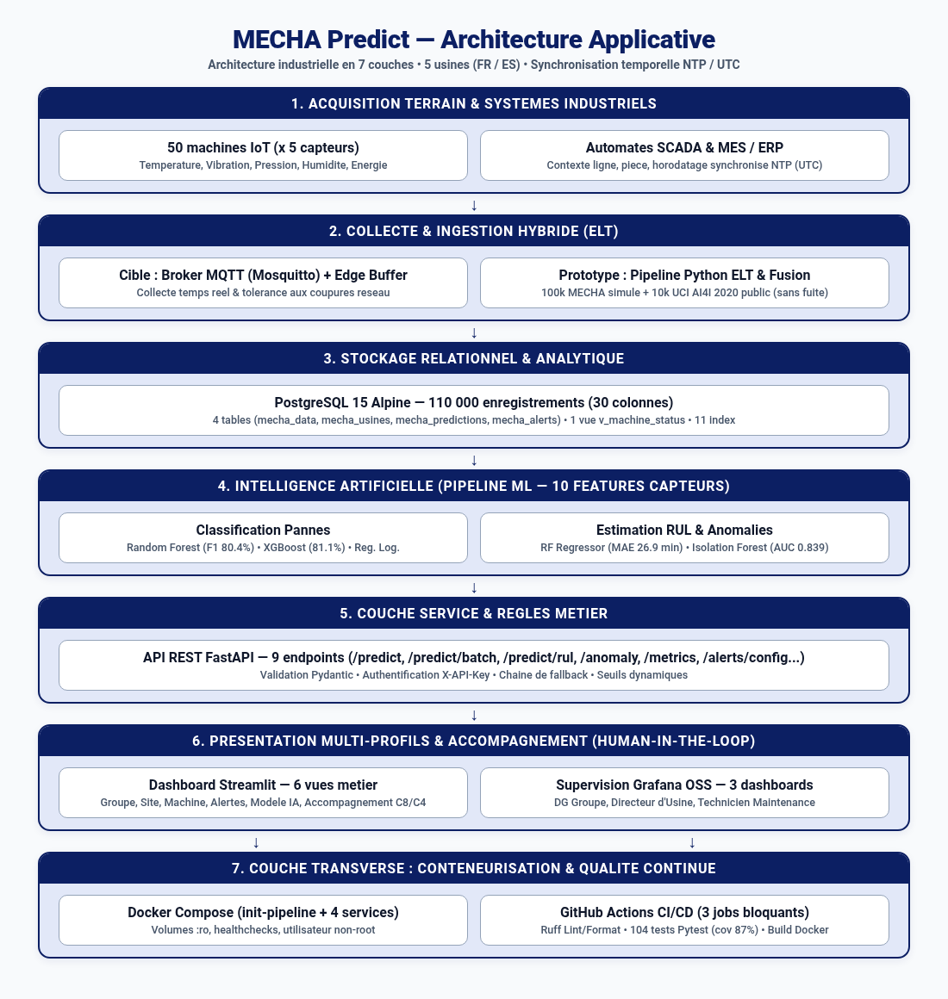

### 3.2 Justification des choix techniques et criteres C2

Chaque composant a fait l'objet d'un comparatif multicritere detaille dans `docs/technical_choices.md` :

| Composant | Choix retenu | Alternatives evaluees | Critere decisif |
|-----------|-------------|----------------------|-----------------|
| Langage | Python 3.11 | R, Java 21, Julia | Unification Data + ML + API + Dashboard |
| Framework ML | scikit-learn + XGBoost | TensorFlow, PyTorch, H2O | Performance tabulaire, explicabilite native EU AI Act |
| Classification | Random Forest (principal) + XGBoost (secours) | SVM, Reg. Logistique | Rappel 90 %, robustesse au bruit capteur |
| Regression RUL | RandomForestRegressor | LSTM, SVR | MAE 26,9 min sans GPU, explicabilite directe |
| Framework API | FastAPI + Pydantic | Flask, Django REST, Express | Validation stricte des entrees, OpenAPI natif |
| Analyse & C8 | Streamlit (6 vues) | Dash, Metabase, Power BI | Integration native API ML, qualification terrain C8 |
| Monitoring temps reel | Grafana OSS (3 dashboards) | Kibana, Datadog | Standard industriel, provisioning YAML/JSON |
| Base de donnees | PostgreSQL 15 Alpine | MongoDB, InfluxDB, MySQL | Conformite ACID, JSONB, vue temps reel, TimescaleDB |
| Conteneurisation | Docker + Docker Compose | Kubernetes, VM | Reproductibilite immediate (`init-pipeline` + 4 services) |
| Qualite & CI/CD | GitHub Actions + Ruff + Pytest | Jenkins, GitLab CI, Flake8 | Rapidite Rust (Ruff), zero infrastructure, 104 tests |

**Conformite aux 4 criteres d'evaluation de la grille C2 :**
- **Stabilite** : versions d'images figees, validation Pydantic bornant physiquement chaque capteur (`HTTP 422` sur valeurs hors limites), integrite relationnelle ACID PostgreSQL 15.
- **Efficacite** : endpoint vectorise `POST /predict/batch` (< 25 ms pour 100 machines), 11 index B-Tree SQL, vue `v_machine_status` (`DISTINCT ON`), modeles compresses avec `joblib compress=3` (32 Mo au total).
- **Perennite** : separation stricte des couches (code structure en modules independants `data/`, `models/`, `api/`, `app/`, `db/`, `grafana/`), gestion Git par branches fonctionnelles et Pull Requests, absence totale de *vendor lock-in*.
- **Tolerance aux pannes** : chaine de triple fallback dans l'API (`Random Forest -> XGBoost -> heuristique physique`), mode degrade automatique dans Streamlit si l'API est hors ligne, healthchecks Docker sur les 4 services, et tampon local SQLite sur *Edge Gateway* en cible multi-sites.

### 3.3 Modele physique de la base de donnees PostgreSQL 15

Le schema SQL (`db/init.sql`) instancie **4 tables relationnelles**, **1 vue temps reel** pour Grafana et **11 index d'optimisation** :

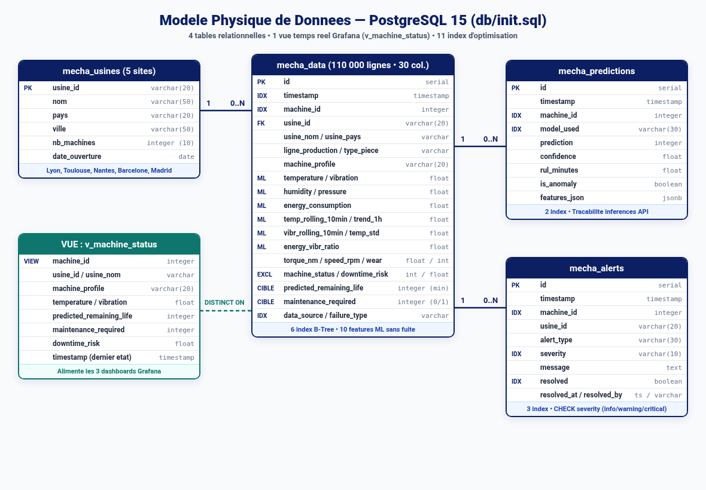

---

## 4. Pipeline de donnees et feature engineering

### 4.1 Construction du dataset hybride et conformite industrielle (Sujet p.4)

Conformement aux consignes strictes de confidentialite industrielle du sujet TPRE841 (interdiction d'exploiter des donnees industrielles privees reelles non publiques), le jeu de donnees repose exclusivement sur une **combinaison transparente de simulation physique et d'un benchmark academique public ouvert** :

1. **Source 1 — Dataset MECHA simule (`100 000 enregistrements`, machines IDs `1 a 50`)** : genere par `data/scripts/generate_data.py` sur les 5 usines (10 machines par site, 2 000 points par machine) en modelisant les cycles jour/nuit (production 6h–22h), 4 profils de robustesse (*Robuste, Standard, Fragile, Vieillissante*), la degradation progressive et les remises en etat apres intervention.
2. **Source 2 — Benchmark public communautaire UCI AI4I 2020 (`10 000 enregistrements`, machines IDs `51 a 100`)** : jeu de reference ouvert publie par l'UCI Machine Learning Repository sous licence *CC BY 4.0* (aucune donnee privee d'entreprise). Le script `data/scripts/merge_datasets.py` convertit les temperatures Kelvin en Celsius, derive un indicateur vibratoire, harmonise les 30 colonnes et force le typage entier nullable `"Int64"` pour garantir un chargement `\COPY` PostgreSQL sans erreur.

### 4.2 Feature engineering temporel et dictionnaire de donnees

Six variables enrichies sont calculees chronologiquement par machine : `temp_rolling_10min`, `temp_trend_1h`, `vibr_rolling_10min`, `temp_std_30min`, `energy_vibr_ratio` et `downtime_risk` (ce dernier etant reserve a l'affichage analytique et strictement exclu des entrees ML). L'ensemble des **30 colonnes** est documente dans `data/data_dictionary.md` (v3.1).

---

## 5. Modelisation et intelligence artificielle (C3)

### 5.1 Protocole experimental rigoureux sans fuite de donnees

- **Split temporel 80/20 stratifie par source** : tri chronologique effectue separement sur MECHA simule et sur UCI AI4I (`88 000` lignes d'entrainement / `22 000` lignes de test), evitant toute fuite du futur vers le passe tout en garantissant la presence des deux sources en entrainement et en evaluation.
- **Exclusion stricte des variables de fuite (*Data Leakage*)** : `machine_status`, `predicted_remaining_life` et `downtime_risk` sont bannis des entrees ML (`LEAKY_FEATURES`). Seules **10 variables capteurs et temporelles** alimentent les modeles. Un jeu de tests automatises (`test_data_quality.py`, `test_api.py`) verrouille cette regle.
- **Traitement du desequilibre (4,7 % de pannes)** : `class_weight='balanced'` sur Random Forest et `scale_pos_weight` automatique sur XGBoost (`RANDOM_STATE = 42`).

### 5.2 Resultats compares des 5 modeles sur le jeu de test (22 000 lignes)

| Modele | Type | Accuracy | Precision | Rappel | F1-Score | AUC-ROC / R2 |
|--------|------|:--------:|:---------:|:------:|:--------:|:------------:|
| **Random Forest** (Principal) | Classification | 97,9 % | 72,7 % | **90,0 %** | **80,4 %** | AUC = **0,988** |
| **XGBoost** (Secours API) | Classification | 98,1 % | 74,8 % | 88,6 % | **81,1 %** | AUC = **0,988** |
| **Regression Logistique** | Baseline | 71,4 % | 13,4 % | 92,0 % | 23,3 % | AUC = 0,895 |
| **Isolation Forest** | Anomalies | 93,0 % | 29,4 % | 34,7 % | 31,8 % | AUC = **0,839** |
| **RF Regressor RUL** | Regression | — | — | — | MAE = **26,9 min** | **R2 = 0,719** |

**Ventilation transparente par source (Random Forest)** :
- Sur **MECHA simule** (`20 000` lignes test) : Precision = `73,5 %`, Rappel = `93,3 %`, **F1 = `82,2 %`**.
- Sur **UCI AI4I 2020** (`2 000` lignes test) : **F1 = `7,3 %`**, car les pannes physiques AI4I dependent principalement du couple (`torque_nm`) et de l'usure d'outil (`tool_wear_min`), volontairement exclus des 10 capteurs communs aux 100 machines. Cette limite est documentee dans les 5 *Model Cards* (`models/model_cards/`).

**Top 3 d'importance des variables (Random Forest)** : `temp_rolling_10min` (**33 %**), `temperature` (**19 %**), `vibr_rolling_10min` (**17 %**).

---

## 6. AMDEC — Analyse des Modes de Defaillance

L'analyse AMDEC croise les modes de defaillance physiques du parc d'usinage et les risques propres au systeme d'IA :

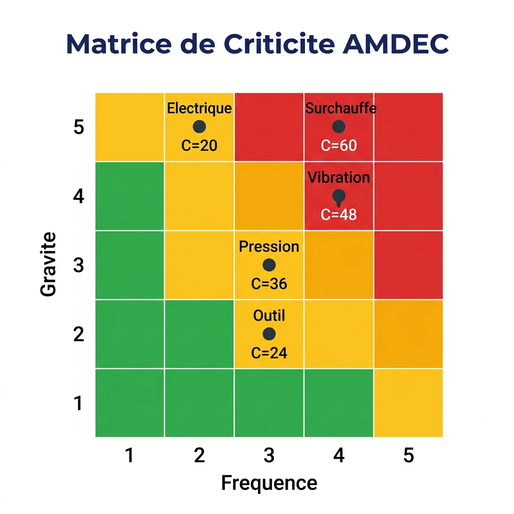

| Mode de defaillance | Criticite initiale (F x G x D) | Action predictive MECHA Predict | Criticite residuelle | Gain |
|---------------------|:------------------------------:|---------------------------------|:--------------------:|:----:|
| **Surchauffe (> 100 C)** | **60** (4 x 5 x 3) | Detection derive `temp_rolling_10min` + RUL | **24** | -60 % |
| **Vibration roulements (> 70 mm/s)** | **48** (4 x 4 x 3) | Alerte precoce `vibr_rolling_10min` + Isolation Forest | **24** | -50 % |
| **Chute de pression (< 2,0 bar)** | **36** (3 x 3 x 4) | Surveillance seuil + anomalie multivariee | **18** | -50 % |
| **Usure d'outil** | **24** (3 x 2 x 4) | Estimation `POST /predict/rul` | **8** | -67 % |
| **Defaut electrique (> 6 kW)** | **20** (2 x 5 x 2) | Ratio `energy_vibr_ratio` + Isolation Forest | **12** | -40 % |

---

## 7. Solution applicative integree et parametrage (C4)

### 7.1 API REST FastAPI (`api/main.py` — 1 189 lignes)

L'API expose **9 routes REST** documentees sous Swagger (`/docs`) : `GET /health`, `POST /predict`, `POST /predict/batch`, `POST /predict/rul`, `POST /anomaly`, `GET /metrics`, `GET /model-info`, `GET /alerts/config` et `PUT /alerts/config`.

### 7.2 Dashboard metier Streamlit — 6 vues operationnelles (`app/src/dashboard.py` — 1 955 lignes)

Le dashboard consomme exclusivement l'API REST pour toutes les predictions ML et propose **6 vues adaptees aux profils metiers** :

1. **Vue 1 — Groupe (Direction Generale)** : TRS consolide, taux de maintenance, RUL moyen et benchmark des 5 sites.
2. **Vue 2 — Site (Directeur d'Usine)** : etat detaille des machines d'un site avec inférence batch temps reel (`POST /predict/batch`).

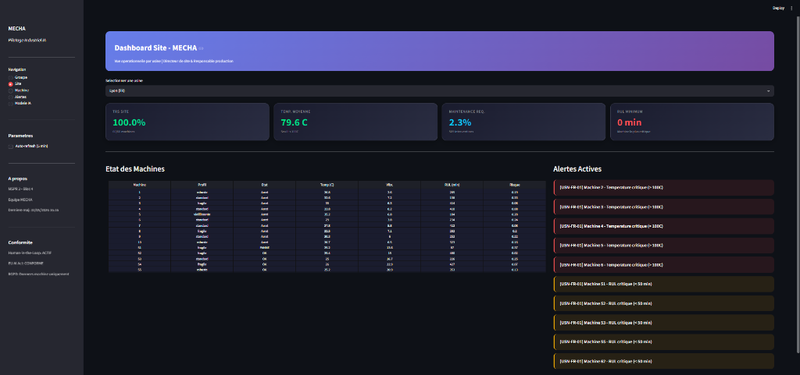

3. **Vue 3 — Machine (Equipe Maintenance)** : courbes capteurs, jauge de risque IA, estimation RUL (`POST /predict/rul`) et facteurs d'anomalie (`POST /anomaly`).

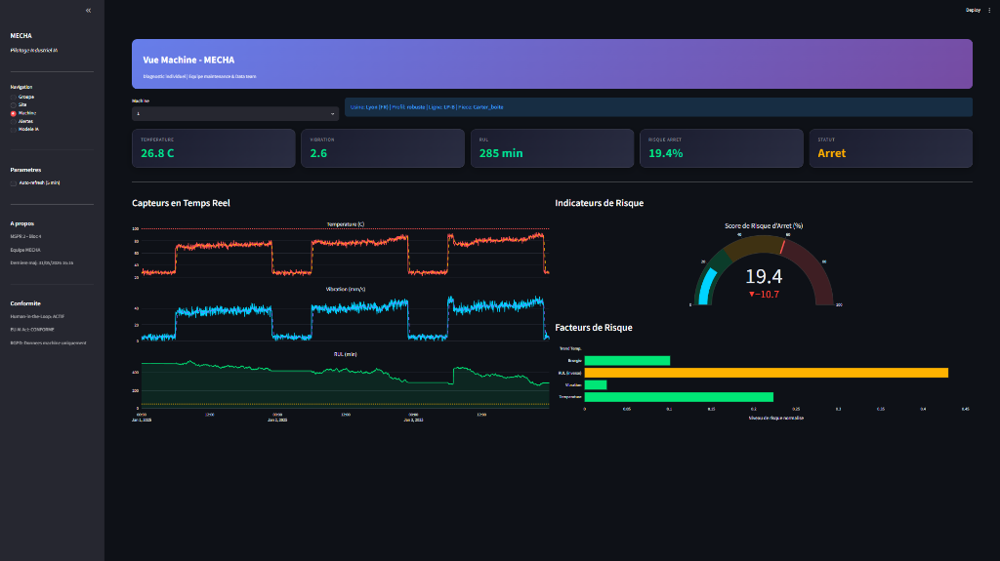

4. **Vue 4 — Alertes (Supervision transverse)** : centre d'alertes unifie filtrable par severite, site et source (seuil physique ou prediction IA).

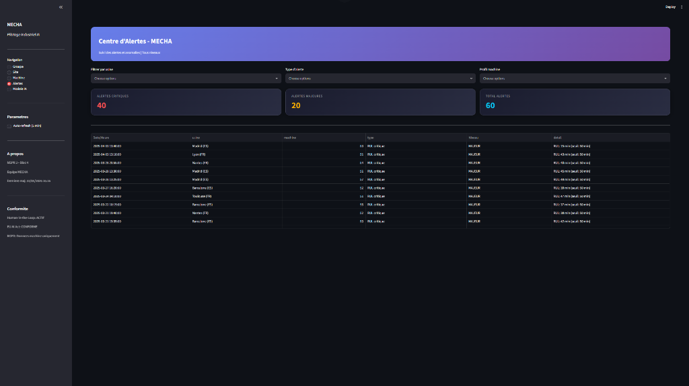

5. **Vue 5 — Modele IA (Data Team)** : metriques issues de `GET /metrics` ventilees par source, importance des 10 features et conformite EU AI Act.

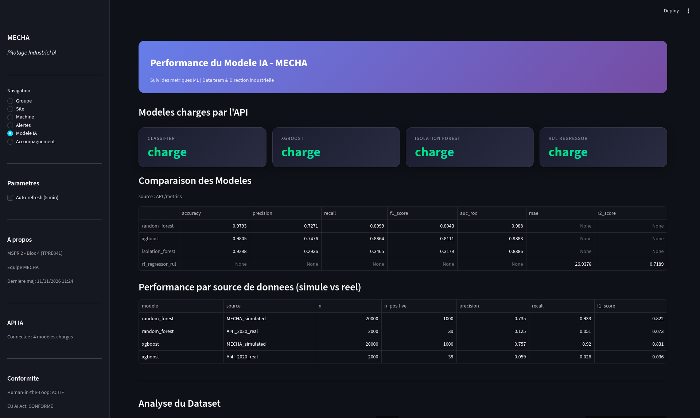

6. **Vue 6 — Accompagnement (Conduite du changement C8 & Parametrage C4)** : espace operationnel permettant aux techniciens de qualifier les alertes IA (*Human-in-the-Loop* anonyme), de consulter les fiches reflexes par role et d'ajuster dynamiquement les seuils d'alerte de l'API.

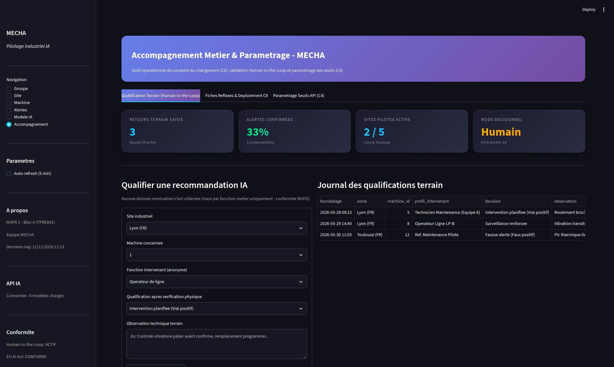

### 7.3 Supervision temps reel Grafana — 3 tableaux de bord par role

Retenu des la MSPR TPRE831, Grafana OSS interroge PostgreSQL (`v_machine_status`) pour offrir trois vues temps reel complementaires :

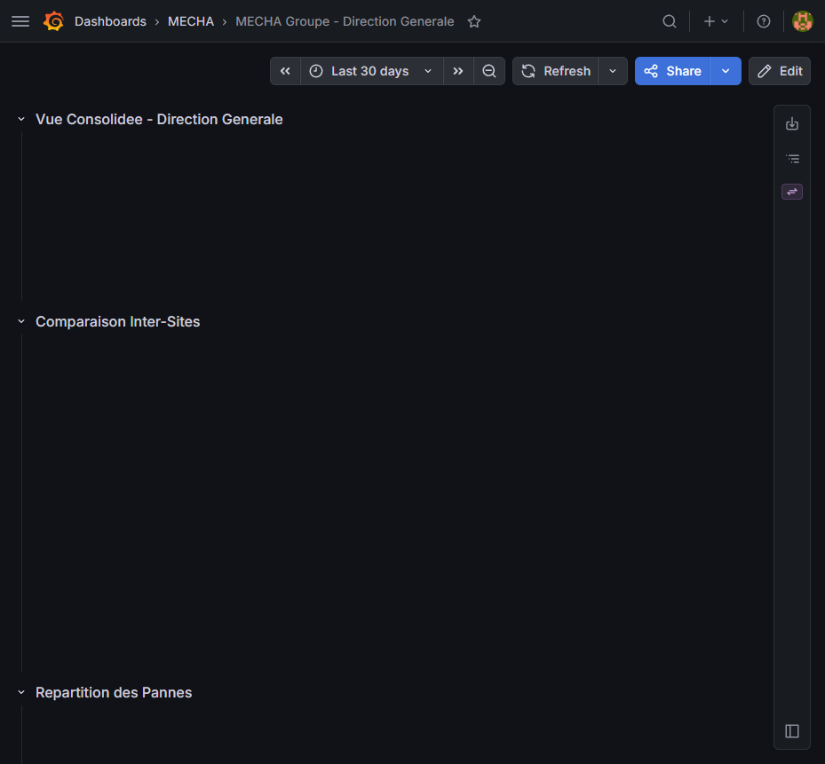

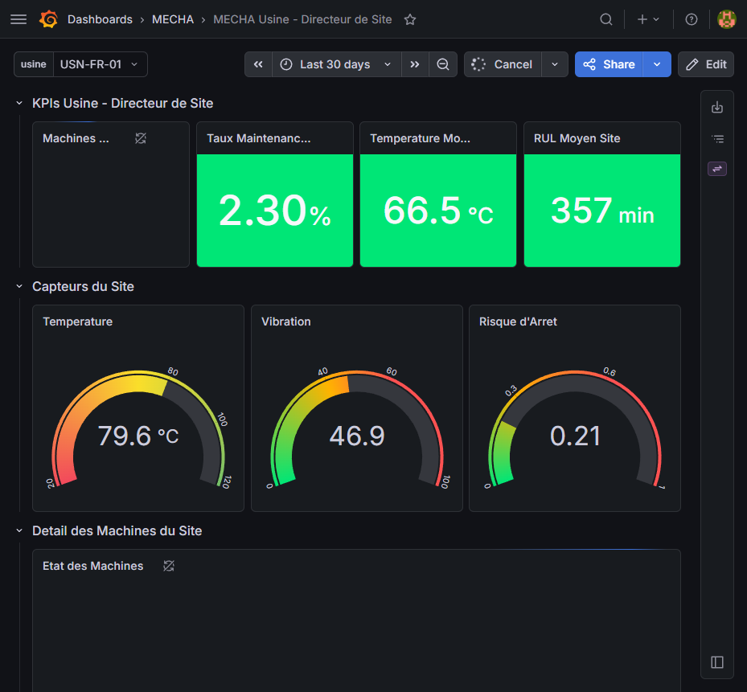

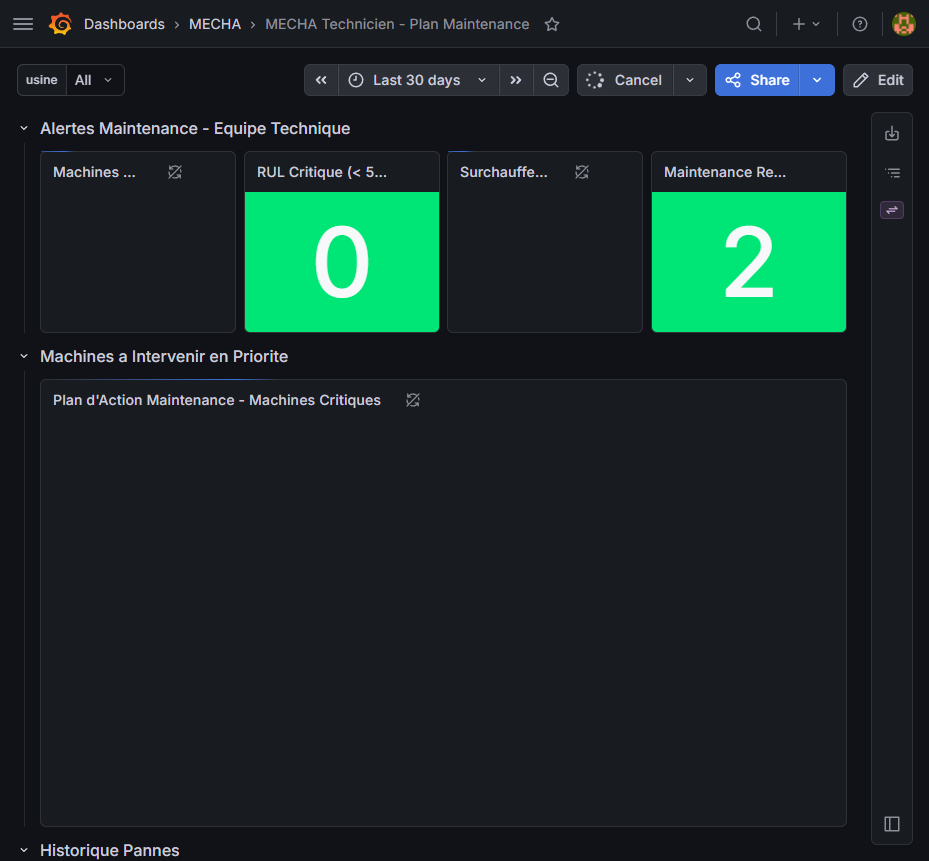

### 7.4 Parametrage logiciel et formalisme de configuration (Attendu C4)

La solution evite tout codage rigide grace a quatre niveaux de parametrage formel :
- **Provisioning YAML Grafana** (`grafana/provisioning/datasources/datasource.yml` et `dashboards/dashboard.yml`) injectant automatiquement la connexion PostgreSQL (`$__env{POSTGRES_PASSWORD}`) et les dossiers de dashboards au demarrage du conteneur.
- **Dashboards JSON et vue SQL `v_machine_status`** parametrables par variable d'usine (`$usine`).
- **Variables d'environnement `.env`** controlant les ports, secrets, `MODEL_PATH`, `PREDICTION_THRESHOLD` (`0.5`) et `API_KEY`.
- **Modification dynamique a chaud via `GET/PUT /alerts/config`** permettant d'adapter les seuils critiques (temperature, taux de rebuts, TRS minimum, taux d'anomalies) directement depuis l'interface Streamlit sans redemarrer les conteneurs.

---

## 8. Tests, validation et plan de correction (C5)

### 8.1 Campagne de 104 tests automatises (100 % PASS)

La qualite fonctionnelle et technique est verifiee par **104 tests automatises `pytest`** executes sans aucun test ignore (`0 skipped`), documentes dans `docs/validation_plan.md` :

| Fichier de test | Nb tests | Perimetre verifie | Resultat |
|-----------------|:--------:|-------------------|:--------:|
| `tests/test_data_quality.py` | **21** | Structure 110k lignes, plages physiques, absence de fuite (`machine_status`), compatibilite entiere `\COPY` PostgreSQL | **21 / 21 PASS** |
| `tests/test_model.py` | **16** | Chargement des 5 `.joblib`, alignement des 10 features entrainement <-> API, inférence reelle hors mock | **16 / 16 PASS** |
| `api/tests/test_api.py` | **61** | Validation Pydantic des 9 routes, securite `X-API-Key`, cas limites, `PUT /alerts/config` (**couverture `api/main.py` : 87 %**) | **61 / 61 PASS** |
| `tests/test_integration.py` | **6** | Scenarios bout-en-bout : machine saine (`SAMPLE_NORMAL`) vs critique (`SAMPLE_CRITICAL`), coherence batch/unitaire | **6 / 6 PASS** |
| **TOTAL** | **104** | **Couverture globale API + Pipeline validee en CI** | **104 / 104 PASS** |

### 8.2 Plan de correction des anomalies identifiees en revue

Cinq anomalies critiques detectees durant le cycle de verification ont ete corrigees et verrouillees par tests de non-regression (`CORR-01` a `CORR-05` dans `docs/validation_plan.md`) : suppression des 2 variables de fuite (`predicted_remaining_life`, `downtime_risk`), alignement des noms de fichiers `.joblib` avec l'API, split temporel stratifie par source, typage `Int64` pour PostgreSQL `\COPY`, et montage du repertoire `data/processed` avec conteneur `init-pipeline`.

---

## 9. Integration continue (C6)

La pipeline GitHub Actions (`.github/workflows/ci.yml`) orchestre automatiquement **3 jobs sequentiels bloquants** a chaque push ou Pull Request :

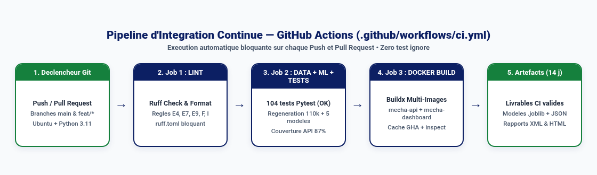

1. **Job 1 — Lint & Format (`Ruff`)** : controle statique ultra-rapide selon `ruff.toml` (`ruff check` + `ruff format --check`).
2. **Job 2 — Data, Entrainement ML & 104 Tests (`Pytest`)** : regenere integralement les 110 000 lignes et les 5 modeles, verifie que `GET /health` retourne `models_loaded = true`, execute les 104 tests avec mesure de couverture (`--cov=api --cov=models`) et archive les artefacts pendant 14 jours.
3. **Job 3 — Build Docker (`Buildx`)** : construit et inspecte en parallele les images `mecha-api` et `mecha-dashboard`.

---

## 10. Documentation utilisateur et conformite (C7)

### 10.1 Guide utilisateur metier synthetique de 2 pages

Conformement aux exigences du sujet (guide metier de 1 a 2 pages destine aux equipes non-data), le document `docs/user_guide.md` (exporte en exactement **2 pages A4** dans `livrables/02_Documentation_et_Validation/07_Guide_Utilisateur_Metier_2pages_C7.pdf`) presente sans jargon algorithmique : l'objectif de l'outil, la navigation dans les 6 vues Streamlit et les 3 vues Grafana, la grille de lecture des codes couleurs (risque et RUL), la procedure d'intervention en 4 etapes et les limites d'usage (*Human-in-the-Loop*).

### 10.2 Verification de conformite au cahier des charges TPRE841

| Livrable / Exigence officielle du sujet | Realisation dans le depot | Statut |
|-----------------------------------------|---------------------------|:------:|
| Code source structure et versionne Git | Depot GitHub modulaire + workflow PR + `ruff.toml` | Conforme |
| Jeux de donnees exploitables + dictionnaire | `110 000 lignes` (simule + UCI AI4I public) + `data_dictionary.md` v3.1 | Conforme |
| Modeles ML entraines + metriques + fiches | 5 modeles `.joblib` compresses + JSON + 5 *Model Cards* | Conforme |
| Solution integree parametrable (API + BI) | FastAPI (9 routes) + Streamlit (6 vues) + Grafana (3 vues YAML/JSON) | Conforme |
| Conteneurisation reproductible | `docker-compose.yml` (`init-pipeline` + 4 services avec healthchecks) | Conforme |
| Pipeline CI/CD fonctionnelle | `.github/workflows/ci.yml` (Lint -> 104 Tests -> Build Docker) | Conforme |
| Plan de tests, rapport d'execution et corrections | `docs/validation_plan.md` (104/104 PASS + `CORR-01..05`) | Conforme |
| Guide utilisateur metier (1–2 pages) | `docs/user_guide.md` (`07_Guide_Utilisateur_Metier_2pages_C7.pdf`, 2 pages) | Conforme |
| Conduite du changement + outil concret | `docs/change_management.md` + Vue Streamlit `Accompagnement` | Conforme |
| Conformite RGPD et EU AI Act | `docs/rgpd_analysis.md` + confidentialite industrielle respectee | Conforme |

---

## 11. Conduite du changement et outil d'accompagnement (C8)

Au-dela du cadrage methodologique complet (`docs/change_management.md` : cartographie des 5 populations, **4 axes Informer / Communiquer / Former / Faire participer**, **FutureWheel** et modele transitionnel de **William Bridges**), l'equipe a developpe un **outil operationnel directement integre a l'application** (6e vue Streamlit **`Accompagnement`**) :
- **Qualification terrain *Human-in-the-Loop*** : formulaire permettant aux techniciens de valider ou contester une alerte IA en moins de 15 secondes, sans aucun identifiant nominatif (conformite RGPD stricte), alimentant le calcul en direct du taux d'accord IA/terrain et du taux de fausses alertes percues ;
- **Fiches reflexes interactives par profil** (*Technicien Maintenance*, *Directeur d'Usine*, *Direction Generale*) et suivi d'avancement des 4 phases de deploiement ;
- ** Calibration participative des seuils** via connexion directe a `PUT /alerts/config`.

---

## 12. Conformite reglementaire — RGPD et EU AI Act

- **Confidentialite industrielle et RGPD (`docs/rgpd_analysis.md`)** : la plateforme traite exclusivement des grandeurs physiques machines (`temperature`, `vibration`, `pressure`, etc.). Aucun badgeage ni identifiant d'operateur n'est collecte, ecartant tout risque de surveillance individuelle des salaries (conformite CNIL et *LOPDGDD* espagnole).
- **EU AI Act (Reglement UE 2024/1689)** : le systeme est qualifie d'outil d'aide a la decision industrielle a **risque limite**, assorti de 5 *Model Cards* transparentes, d'indicateurs d'importance des variables et d'une validation humaine obligatoire avant tout ordre d'arret machine.

---

## 13. Plan de deploiement multi-sites

Le deploiement industriel sur **12 mois** (`docs/deployment_plan.md`) suit une approche progressive securisee sur les **50 machines MECHA** :

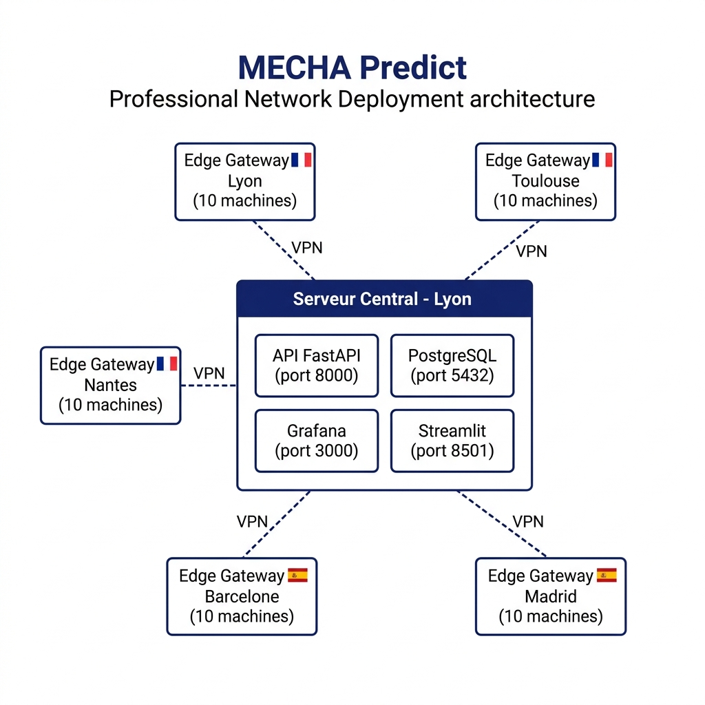

1. **Phase 1 — Pilote Lyon (M1–M3, 10 machines)** : installation serveur central, double run d'observation, calibration des seuils.
2. **Phase 2 — Extension France Toulouse & Nantes (M4–M6, +20 machines)** : interconnexion VPN WireGuard, exigences aeronautiques EN 9100.
3. **Phase 3 — Extension Espagne Barcelone & Madrid (M7–M9, +20 machines)** : internationalisation espagnole de l'interface et du guide utilisateur, conformite *LOPDGDD*.
4. **Phase 4 — Stabilisation Groupe (M10–M12, 50 machines)** : re-entrainement trimestriel et audit ROI. Chaque jalon est conditionne par une grille **Go/No-Go** (disponibilite capteurs >= 95 %, rappel >= 85 %, fausses alertes <= 15 %) et un **plan de rollback < 15 minutes**.

---

## 14. Bilan, limites et perspectives

### 14.1 Synthese quantitative du projet livre

| Indicateur | Valeur verifiee |
|------------|-----------------|
| Volume de code Python applicatif et tests | **6 614 lignes** (`api`, `app`, `data`, `models`, `tests`) |
| Jeu de donnees exploitable | **110 000 enregistrements**, 30 colonnes, 100 machines, 5 usines |
| Modeles ML entraines et compresses | **5 modeles `.joblib`** (32 Mo au total) + 5 *Model Cards* |
| API REST & Interfaces | **9 routes FastAPI** + **6 vues Streamlit** + **3 dashboards Grafana** |
| Campagne de tests automatises | **104 tests passants (`100 % PASS`)**, couverture `api/main.py` **87 %** |
| Livrables documentaires prets a envoyer | **1 rapport consolide PDF + 10 PDF individuels + diaporama PPTX/PDF** |
| Couverture du referentiel RNCP35584 Bloc 4 | **8 competences validees sur 8 (`C1` a `C8`)** |

### 14.2 Limites assumees et perspectives techniques
- **Ecart domaine simule vs benchmark UCI AI4I (F1 = 7,3 % sur AI4I)** : l'ajout futur de modeles specialises par famille d'equipement integrant le couple (`torque_nm`) et l'usure d'outil (`tool_wear_min`) permettra de couvrir les centres d'usinage CNC specifiques.
- **Evolution vers TimescaleDB, MLflow et Kubernetes** : prevue des le depassement du seuil de 100 machines ou de 2 ans d'historique continu.
- **ROI projete** : **200 000 a 300 000 euros d'economies annuelles** pour un investissement initial de **150 000 euros**, soit un amortissement complet en **moins de 12 mois**.

---

## 15. Annexes et tracabilite IA generative

### 15.1 Inventaire des composants techniques

| Module | Fichiers principaux | Volume |
|--------|---------------------|--------|
| API FastAPI | `api/main.py`, `api/Dockerfile`, `api/tests/test_api.py` | 1 933 lignes Python |
| Dashboard Streamlit | `app/src/dashboard.py`, `app/Dockerfile` | 1 955 lignes Python |
| Pipeline Data | `data/scripts/generate_data.py`, `data/scripts/merge_datasets.py` | 1 111 lignes Python |
| Pipeline ML | `models/training/train_models.py`, `models/model_cards/*.md` | 1 008 lignes Python |
| Base SQL & Grafana | `db/init.sql`, `db/load_data.sh`, `grafana/provisioning/*`, `grafana/dashboards/*.json` | 4 tables, 1 vue, 11 index, 3 JSON |
| Suites de tests transverses | `tests/test_data_quality.py`, `tests/test_model.py`, `tests/test_integration.py` | 607 lignes Python |

### 15.2 Capture complementaire — Surveillance thermique multi-jours

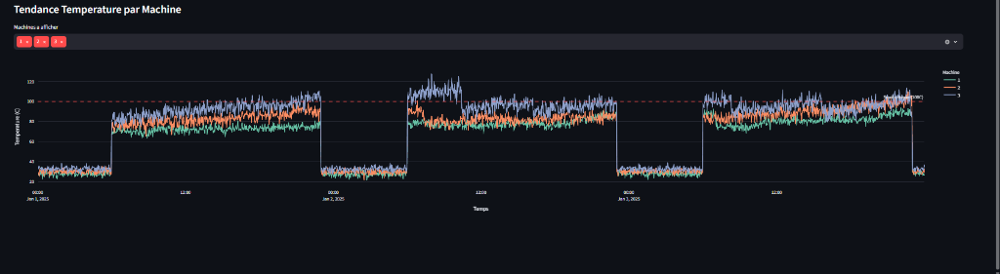

### 15.3 Tracabilite et analyse critique de l'usage d'outils d'IA generative (Exigence Sujet TPRE841)

Conformement aux recommandations pedagogiques du sujet concernant l'usage raisonne et documente de l'IA generative, l'equipe a mobilise des assistants de generation de code et de structuration documentaire comme **accelerateurs de productivite**, tout en exercant une **revue critique systematique** :

| Usage / Prompt type soumis | Apport initial de l'outil | Limite ou erreur detectee par l'equipe | Correction humaine appliquee et verifiee |
|----------------------------|---------------------------|----------------------------------------|------------------------------------------|
| *« Generer un pipeline scikit-learn d'entrainement Random Forest et XGBoost sur le dataset fusionne MECHA »* | Squelette propre des fonctions d'entrainement et d'export JSON des metriques. | L'assistant incluait toutes les colonnes numeriques en entree, dont `predicted_remaining_life` et `downtime_risk` (**fuite de cible** donnant un faux F1 de 99 % sur simule et 0,6 % sur reel avec un split global). | Creation de `LEAKY_FEATURES`, restriction stricte aux **10 features capteurs**, implementation du **split temporel 80/20 par source** et ajout de tests anti-fuite dans `test_data_quality.py` et `test_api.py`. |
| *« Ecrire le script pandas de fusion entre MECHA simule et AI4I 2020 pour import PostgreSQL »* | Harmonisation rapide des unites Kelvin -> Celsius. | Les `NaN` introduits sur les colonnes absentes transformaient les colonnes entieres (`rotational_speed_rpm`, `tool_wear_min`) en flottants (`"2636.0"`), faisant echouer la commande PostgreSQL `\COPY`. | Cast explicite vers le type entier nullable pandas `"Int64"` dans `merge_datasets.py` et ajout de la classe `TestPostgreSQLCopyCompatibility` dans `tests/test_data_quality.py`. |
| *« Structurer les grilles AMDEC, RGPD et le plan de conduite du changement »* | Trame redactionnelle claire selon les referentiels Bridges et EU AI Act. | Certaines sections restaient purement theoriques ou mentionnaient des routes API fictives (`/machines`). | Alignement integral de la documentation sur le code reellement livre et developpement de la **6e vue Streamlit `Accompagnement`** pour concretiser la competence C8. |

### 15.4 References normatives et bibliographiques

- Reglement (UE) 2024/1689 (*EU AI Act*) & Reglement (UE) 2016/679 (*RGPD*) / *LOPDGDD* (Espagne)
- Normes industrielles : *EN 9100* (aeronautique), *IATF 16949* (automobile), *IEC 62443* (cybersecurite OT), *NIS 2*
- Jeu de donnees public : *UCI AI4I 2020 Predictive Maintenance Dataset* (Matzka, S., 2020 — CC BY 4.0)
- Documentation officielle : *scikit-learn*, *XGBoost*, *FastAPI*, *Streamlit*, *Grafana OSS*, *PostgreSQL 15*

---

> **Document valide par** : Malek El Fayedh, Thibaut Doreau, Vincent Goncalves, Pierre-Louis Guinel  
> **Date de validation** : Mai 2026 — Depot officiel : `https://github.com/HASHT85/MSPR2-MECHA`
