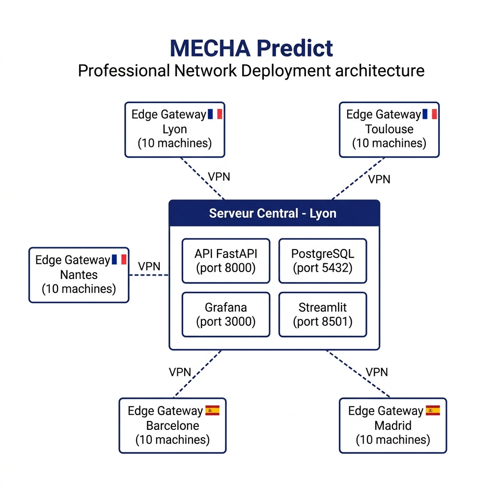
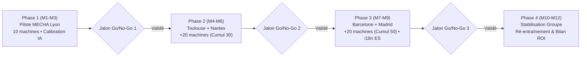

# Plan de Déploiement Multi-Sites et Mise en Production — MECHA Predict

> **Projet** : MECHA Predict — Maintenance Prédictive Industrielle par IA  
> **Certification** : RNCP35584 — Expert en Informatique et Système d'Information (Bloc 4 — MSPR TPRE841)  
> **Version** : 2.0  
> **Date** : Mai 2026  
> **Auteurs** : Malek El Fayedh, Thibaut Doreau, Vincent Gonçalves, Pierre-Louis Guinel  
> **Compétences couvertes** : **C4 — Solution applicative intégrée** & **C8 — Conduite du changement**

---

## 1. Périmètre et Objectifs du Déploiement

Ce document formalise la trajectoire d'industrialisation de **MECHA Predict** sur les **5 sites européens** du groupe MECHA (**50 machines industrielles MECHA**, soit **10 machines par usine** conformément au référentiel PostgreSQL `mecha_usines` et au générateur `generate_data.py`).

| Code Site | Usine | Pays | Machines MECHA | Spécialité dominante | Ordre de déploiement |
|-----------|-------|------|:--------------:|----------------------|:--------------------:|
| `USN-FR-01` | **MECHA Lyon** | France | **10** | Aéronautique + Automobile (Siège) | **Phase 1 — Site Pilote** |
| `USN-FR-02` | **MECHA Toulouse** | France | **10** | Aéronautique (EN 9100) | Phase 2 — Extension France |
| `USN-FR-03` | **MECHA Nantes** | France | **10** | Aéronautique (EN 9100) | Phase 2 — Extension France |
| `USN-ES-01` | **MECHA Barcelone** | Espagne | **10** | Automobile (IATF 16949) | Phase 3 — International |
| `USN-ES-02` | **MECHA Madrid** | Espagne | **10** | Automobile (IATF 16949) | Phase 3 — International |

| Indicateur de succès | Situation initiale | Cible fin de déploiement (M+12) |
|----------------------|:------------------:|:-------------------------------:|
| Couverture du parc MECHA | 0 / 50 machines | **50 / 50 machines (100 %)** |
| Réduction des arrêts non planifiés | 12 à 18 arrêts / mois | **<= 5 arrêts / mois (-60 %)** |
| Disponibilité opérationnelle (TRS / OEE) | 87–88 % | **>= 95 %** |
| Taux d'adoption hebdomadaire des équipes | — | **>= 90 %** |

---

## 2. Architecture Réseau Multi-Sites et Prérequis Industriels

### 2.1 Prérequis techniques et synchronisation temporelle
- **Réseau atelier (OT)** : Ethernet industriel >= 100 Mbps segmenté (VLAN dédié capteurs/SCADA conforme IEC 62443) + Wi-Fi 802.11ac redondant.
- **Interconnexion inter-sites (IT/OT)** : tunnels VPN chiffrés **WireGuard / IPsec** reliant les 5 *Edge Gateways* locales au serveur central hébergé à **Lyon**.
- **Synchronisation horaire multi-sites** : démon **NTP (`chronyd`)** configuré en UTC sur chaque passerelle Edge et automate SCADA afin de garantir la cohérence temporelle stricte des séries à la milliseconde entre la France et l'Espagne.
- **Buffer local anti-coupure** : chaque *Edge Gateway* (2 vCPU, 4 Go RAM, 64 Go SSD) embarque un broker Mosquitto local et une file SQLite capable de stocker 72h de télémétries en cas d'indisponibilité réseau.

### 2.2 Matrice des flux et ports réseau

| Port | Service | Flux | Chiffrement / Sécurité |
|:----:|---------|------|------------------------|
| `8883` | MQTT sur TLS (Mosquitto) | Edge Gateways -> Serveur Central | TLS 1.3 + certificats clients par site |
| `5432` | PostgreSQL 15 | Réseau Docker interne uniquement (`mecha-net`) | Isolé (non exposé sur le WAN), compte `mecha_user` en lecture seule pour Grafana |
| `8000` | API REST FastAPI | Streamlit / Services métiers -> API | HTTPS via reverse-proxy + en-tête `X-API-Key` |
| `8501` | Dashboard Streamlit (6 vues) | Navigateurs utilisateurs -> Reverse-proxy | HTTPS TLS 1.3 + authentification SSO entreprise |
| `3000` | Supervision Grafana (3 vues) | Écrans atelier & Direction -> Reverse-proxy | HTTPS TLS 1.3 + RBAC par rôle (DG, Site, Technicien) |

---

## 3. Planning Progressif en 4 Phases sur 12 Mois

| Phase | Période prévisionnelle | Sites concernés | Livrables et jalons opérationnels |
|-------|------------------------|-----------------|-----------------------------------|
| **Phase 1 — Pilote** | Juin – Août 2026 (3 mois) | **Lyon** (`10` machines) | Déploiement serveur central Docker, connexion SCADA/MES pilote, calibration des seuils via `PUT /alerts/config`, formation équipe Lyon, 1 mois d'observation en double run. |
| **Phase 2 — France** | Sept. – Nov. 2026 (3 mois) | **Toulouse + Nantes** (`+20` machines) | Installation des 2 *Edge Gateways* aéronautiques, ouverture VPN, ré-entraînement des modèles sur mesures réelles françaises, désignation des ambassadeurs terrain. |
| **Phase 3 — Espagne** | Déc. 2026 – Fév. 2027 (3 mois) | **Barcelone + Madrid** (`+20` machines) | Traduction espagnole de l'interface et du guide métier 2 pages, conformité *LOPDGDD*, déploiement des 2 *Edge Gateways* automobiles. |
| **Phase 4 — Stabilisation** | Mars – Mai 2027 (3 mois) | **5 usines** (`50` machines) | Automatisation du ré-entraînement trimestriel, audit de dérive (*concept drift*), bilan financier ROI avec la Direction Générale. |

---

## 4. Paramétrage Métier et Seuils Opérationnels (Alignés sur l'API et le Dataset)

Les seuils initiaux configurés dans `api/main.py` (`AlertThresholds`) et modifiables à chaud dans l'onglet **Accompagnement > Paramétrage Seuils API** du dashboard Streamlit respectent les échelles physiques du dictionnaire de données :

| Paramètre physique / Score IA | Plage nominale | Seuil Warning (Avertissement) | Seuil Critique (Action immédiate) | Délai max de notification |
|-------------------------------|:--------------:|:-----------------------------:|:---------------------------------:|:-------------------------:|
| **Température machine** | `45 – 85 °C` | `> 85 °C` | **`> 100 °C`** | 5 min (Critique) / 15 min (Warning) |
| **Vibration mécanique** | `15 – 50 mm/s` | `> 50 mm/s` | **`> 70 mm/s`** | 5 min (Critique) / 15 min (Warning) |
| **Pression circuit** | `2.5 – 5.0 bar` | `< 2.5 bar` | **`< 1.5 bar`** | 15 min |
| **Énergie consommée** | `1.0 – 5.0 kWh` | `> 5.0 kWh` | **`> 6.0 kWh`** | 15 min |
| **Probabilité panne (RF/XGB)** | `< 30 %` (`low`) | `60 – 80 %` (`high`) | **`>= 80 %` (`critical`)** | Validation *Human-in-the-Loop* |
| **Durée résiduelle (RUL)** | `>= 300 min` (`safe`) | `50 – 150 min` (`soon`) | **`< 50 min` (`urgent`)** | Planification prioritaire sous 30 min |

---

## 5. Procédure Technique de Mise en Production (`docker-compose.yml` Livré)

### 5.1 Orchestration conteneurisée livrée et vérifiée
Le fichier `docker-compose.yml` livré à la racine du dépôt assure un déploiement *zero-touch* reproductible :
1. **`init-pipeline` (`mecha-init`)** : vérifie la présence de `data/processed/mecha_dataset_processed.csv` et des 5 modèles dans `models/saved_models/` ; s'ils sont absents, exécute automatiquement `generate_data.py`, `merge_datasets.py` et `train_models.py`.
2. **`db` (`postgres:15-alpine`)** : exécute `db/init.sql` (4 tables, vue `v_machine_status`, 11 index) puis `db/load_data.sh` (`\COPY` des 110 000 lignes typées sans erreur).
3. **`api` (`mecha-api`)** : démarre sous compte non-root `appuser`, monte `./models/saved_models:/app/models/saved_models:ro` et expose les 9 endpoints sur le port `8000`.
4. **`dashboard` (`mecha-dashboard`)** : lance les 6 vues Streamlit en thème sombre industriel sur le port `8501`, connecté à `http://api:8000`.
5. **`grafana` (`grafana/grafana-oss:11.6.0`)** : provisionne automatiquement la source PostgreSQL et les 3 dashboards JSON sur le port `3000`.

### 5.2 Checklist d'installation et de vérification (Runbook Ops)

| Étape | Commande exécutée | Résultat attendu |
|:-----:|-------------------|------------------|
| 1 | `cp .env.example .env && chmod 600 .env` | Secrets base de données, Grafana et `API_KEY` renseignés |
| 2 | `docker compose up --build -d` | `mecha-init` termine avec `exit 0`, les 4 services passent à `healthy` |
| 3 | `curl -fsS http://localhost:8000/health` | `{"status":"healthy","models_loaded":true,...}` |
| 4 | `curl -fsS http://localhost:3000/api/health` | Datasource PostgreSQL et 3 dashboards Grafana opérationnels |
| 5 | `curl -fsS http://localhost:8501/_stcore/health` | Interface Streamlit 6 vues prête (`ok`) |

---

## 6. Critères Go/No-Go et Plan de Rollback Sécurisé

### 6.1 Grille décisionnelle Go/No-Go en fin de chaque phase

| Critère mesuré | Poids | Seuil minimal exigé | Moyen de vérification |
|----------------|:-----:|:-------------------:|-----------------------|
| Disponibilité de collecte capteurs | 20 % | `>= 95 %` des mesures attendues | Dashboard Grafana *Technicien* |
| Rappel détection pannes réelles | 25 % | `>= 85 %` (objectif `90 %`) | Endpoint `GET /metrics` & bilans GMAO |
| Taux de fausses alertes terrain | 20 % | `<= 15 %` après calibration | Journal de qualification *Human-in-the-Loop* (Vue *Accompagnement*) |
| Taux de connexion hebdomadaire | 20 % | `>= 70 %` (Pilote) puis `>= 85 %` | Journaux d'accès applicatifs |
| Satisfaction équipes maintenance | 15 % | `>= 7 / 10` | Enquête REX fin de phase |

### 6.2 Procédure de retour arrière (*Rollback* < 15 minutes)
Un retour arrière immédiat est déclenché si l'API est indisponible plus de 2 heures, si plus de 5 fausses alertes critiques surviennent en 24h, ou sur demande de la Direction Industrielle :
1. Désactivation immédiate des notifications push/SMS tout en conservant l'enregistrement passif des mesures ;
2. Restauration de l'image Docker et du modèle `.joblib` du tag Git stable précédent (`git checkout <tag_stable> && docker compose up -d`) ;
3. Si nécessaire, restauration atomique de la base via sauvegarde quotidienne (`pg_restore -d mecha_db backup_quotidien.dump`) ;
4. Bascule temporaire des équipes sur la procédure de maintenance préventive habituelle sans aucune interruption des lignes d'usinage (la solution étant strictement non intrusive sur les automates de commande).

---

> **Document validé par** : Équipe projet MECHA — Mai 2026
