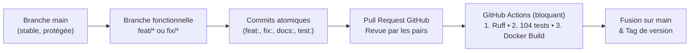

# Justification des Choix Techniques, Modèles IA et Structuration du Code — MECHA Predict

> **Projet** : MECHA Predict — Maintenance Prédictive Industrielle par IA  
> **Certification** : RNCP35584 — Expert en Informatique et Système d'Information (Bloc 4 — MSPR TPRE841, suite de TPRE831)  
> **Version** : 2.0  
> **Date** : Mai 2026  
> **Auteurs** : Malek El Fayedh, Thibaut Doreau, Vincent Gonçalves, Pierre-Louis Guinel  
> **Compétences couvertes** : **C2 — Concevoir une architecture applicative** & **C3 — Développer une application métier**

---

## 1. Introduction et Continuité avec la MSPR TPRE831

Ce document argumente chaque choix technologique, algorithmique et méthodologique de la plateforme **MECHA Predict**, dans la continuité directe de l'étude de faisabilité et du Proof of Concept réalisés lors de la **MSPR TPRE831**. Chaque brique est évaluée face à au moins trois alternatives industrielles selon une grille multicritère pondérée :

| Critère de sélection | Description | Poids |
|----------------------|-------------|:-----:|
| **Maturité & Stabilité** | Fiabilité prouvée en environnement critique, support long terme | 20 % |
| **Performance & Efficacité** | Latence d'inférence, empreinte mémoire, scalabilité multi-sites | 20 % |
| **Compétences Équipe** | Maîtrise partagée par les 4 ingénieurs du groupe pour une vélocité optimale | 20 % |
| **Écosystème & Pérennité** | Richesse documentaire, licences open-source sans *vendor lock-in* | 15 % |
| **Coût Total (TCO)** | Licences logicielles, infrastructure matérielle et maintenance | 15 % |
| **Adéquation Métier & Réglementaire** | Explicabilité IA (*EU AI Act*), traçabilité aéronautique *EN 9100* | 10 % |

---

## 2. Langage de Programmation — Python 3.11

| Critère | Python 3.11 (Retenu) | R | Java 21 | Julia |
|---------|:--------------------:|:-:|:-------:|:-----:|
| Écosystème Data & ML | Excellent (scikit-learn, XGBoost, pandas) | Très bon | Moyen | Moyen |
| Écosystème API & Web | Excellent (FastAPI, Pydantic, Streamlit) | Faible (Shiny) | Excellent (Spring) | Faible |
| Performance d'exécution | Très bonne (noyaux C/C++ vectorisés) | Moyenne | Excellente | Excellente |
| Lisibilité & Maintenabilité | Excellente (typage statique optionnel, Ruff) | Moyenne | Verbeux | Bonne |

**Justification** : Python 3.11 unifie **100 % de la chaîne de valeur** (pipeline de données, entraînement ML, API REST asynchrone, dashboard analytique et tests automatisés) sans rupture technologique ni surcoût de sérialisation inter-langages.

---

## 3. Frameworks et Algorithmes de Machine Learning — scikit-learn & XGBoost

### 3.1 Pourquoi des modèles ensemblistes plutôt que du Deep Learning (LSTM / Transformer) ?

| Critère | scikit-learn + XGBoost (Retenus) | TensorFlow / PyTorch (LSTM) | H2O AutoML |
|---------|:--------------------------------:|:---------------------------:|:----------:|
| Performance sur données tabulaires | **État de l'art** (F1 > 80 %, AUC 0.988) | Inférieure ou équivalente à faible volumétrie | Très bonne |
| Explicabilité (*EU AI Act*) | **Native** (*Feature Importance* directe) | Boîte noire complexe | Partielle |
| Infrastructure requise | CPU standard (< 12 s d'entraînement, < 10 ms/inférence) | GPU requis en entraînement | Lourd (JVM) |

### 3.2 Architecture multi-modèles retenue (5 modèles complémentaires)

Contrairement à une approche mono-modèle, MECHA Predict couvre trois questions opérationnelles complémentaires sur **10 variables capteurs et temporelles** strictement exemptes de fuite de données (*Data Leakage* corrigé par exclusion de `machine_status`, `predicted_remaining_life` et `downtime_risk`) :

| Modèle | Algorithme exact (`train_models.py`) | Question métier traitée | Résultats sur jeu de test (22 000 lignes) |
|--------|--------------------------------------|-------------------------|-------------------------------------------|
| **Modèle principal** | `RandomForestClassifier` (`class_weight='balanced'`) | « Une maintenance est-elle requise ? » | **F1 = 80.43 %**, Rappel = **89.99 %**, AUC = **0.988** |
| **Modèle challenger / secours** | `XGBClassifier` (`scale_pos_weight`) | Fallback supervisé haute précision | **F1 = 81.11 %**, Rappel = **88.64 %**, AUC = **0.988** |
| **Baseline linéaire** | `LogisticRegression` + `StandardScaler` | Référence linéaire de contrôle | F1 = 23.33 %, Rappel = 92.01 %, AUC = 0.895 |
| **Estimation RUL** | `RandomForestRegressor` (`n_estimators=100`) | « Combien de minutes restent avant panne ? » | **MAE = 26.94 min**, RMSE = 46.36 min, **R² = 0.719** |
| **Détection d'anomalies** | `IsolationForest` (`contamination=0.05`) | « Le comportement capteur est-il inédit ? » | **AUC = 0.839**, Accuracy = 92.98 % |

> **Conformité des données d'entraînement (Sujet p.4)** : aucune donnée industrielle confidentielle réelle n'est utilisée. Le corpus hybride associe **100 000 lignes simulées MECHA** et **10 000 lignes publiques communautaires** issues du benchmark ouvert **UCI AI4I 2020 Predictive Maintenance Dataset** (*CC BY 4.0*), avec split temporel 80/20 stratifié par source.

---

## 4. Framework API — FastAPI + Pydantic

| Critère | FastAPI (Retenu) | Flask | Django REST Framework | Express.js |
|---------|:----------------:|:-----:|:---------------------:|:----------:|
| Débit asynchrone | ~15 000 req/s (Starlette/Uvicorn) | ~5 000 req/s | ~3 000 req/s | ~12 000 req/s |
| Validation des entrées | **Pydantic v2 natif** (bornes physiques capteurs) | Manuelle | Serializers lourds | Externe (Zod) |
| Documentation OpenAPI | **Swagger `/docs` auto-généré** | Extension tierce | Extension tierce | Manuelle |

**Justification** : FastAPI garantit la robustesse contractuelle des **9 routes REST** (`SensorInput`, `BatchInput`, `AlertThresholds`), la sécurité par en-tête `X-API-Key` et l'exposition temps réel des métriques d'entraînement.

---

## 5. Stratégie Bi-Outils de Restitution — Grafana OSS + Streamlit

Dans la continuité de la MSPR TPRE831 (où **Grafana** avait été retenu pour le monitoring temps réel), la MSPR TPRE841 complète le dispositif par **Streamlit (6 vues métier)** afin de couvrir l'ensemble des usages opérationnels et analytiques :

| Besoin opérationnel | Grafana OSS (3 dashboards) | Streamlit (6 vues métier) |
|---------------------|:--------------------------:|:-------------------------:|
| Supervision temps réel atelier / DG sur PostgreSQL | **Optimal** (`v_machine_status`) | Complémentaire |
| Diagnostic interactif par machine via API ML (`/predict`, `/rul`, `/anomaly`) | Non natif | **Optimal** |
| Explicabilité des modèles, courbes comparatives et audit par source | Non supporté | **Optimal** (Vue *Modèle IA*) |
| Qualification *Human-in-the-Loop* (C8) & Paramétrage dynamique des seuils (C4) | Non supporté | **Optimal** (Vue *Accompagnement*) |

---

## 6. Stockage Relationnel — PostgreSQL 15 Alpine

| Critère | PostgreSQL 15 (Retenu) | MongoDB | InfluxDB | MySQL 8 |
|---------|:----------------------:|:-------:|:--------:|:-------:|
| Intégrité relationnelle & ACID | **Complète** (4 tables + contraintes CHECK) | Partielle | Absente | Complète |
| Support JSON semi-structuré | **JSONB indexable** (`features_json`) | Natif | Non | Limité |
| Évolutivité séries temporelles | Extension **TimescaleDB** sans migration | Moyenne | Native | Faible |
| Connecteur natif Grafana OSS | **Inclus par défaut** (`datasource.yml`) | Plugin Enterprise | Inclus | Inclus |

---

## 7. Conteneurisation et Orchestration — Docker & Docker Compose

Docker Compose orchestre de manière déterministe **1 conteneur d'initialisation (`init-pipeline`)** et **4 services applicatifs (`db`, `api`, `dashboard`, `grafana`)**. Ce choix offre une reproductibilité immédiate sur tout serveur Linux tout en évitant la complexité d'administration prématurée d'un cluster Kubernetes pour un parc initial de 50 machines.

---

## 8. Qualité Continue et CI/CD — GitHub Actions & Ruff

| Critère | GitHub Actions + Ruff (Retenus) | Jenkins + Flake8/Black | GitLab CI |
|---------|:-------------------------------:|:----------------------:|:---------:|
| Infrastructure à maintenir | **Zéro** (runners managés GitHub) | Serveur JVM dédié | Externe au dépôt |
| Vitesse de lint & formatage | **Ruff** (écrit en Rust, 10 à 50x plus rapide) | Lent (3 outils séparés) | Dépend de l'outil |
| Validation bout-en-bout | Régénération data + 5 modèles + **104 tests Pytest** + Build Docker | Complexe à maintenir | Équivalent |

---

## 9. Principes de Structuration du Code et Modalités de Gestion du Code Source (Git / GitHub)

Conformément aux exigences du sujet MSPR TPRE841 concernant l'ingénierie logicielle, le projet applique des standards stricts de structuration et de versionnement :

### 9.1 Architecture modulaire du code source (*Separation of Concerns*)
Le dépôt est découpé en **modules indépendants et faiblement couplés** :
- **`data/scripts/`** : ingestion, simulation physique (`generate_data.py`) et fusion/harmonisation typée (`merge_datasets.py`). Aucune dépendance vers l'API ou l'UI.
- **`models/training/`** : entraînement reproductible (`RANDOM_STATE = 42`), validation croisée temporelle et export des artefacts compressés (`models/saved_models/`) et métriques (`models/evaluation/results/`).
- **`api/`** : couche de service REST autonome (`api/main.py`, `api/Dockerfile` multi-stage exécuté sous utilisateur non-root `appuser`).
- **`app/`** : client léger de présentation (`app/src/dashboard.py`) consommant exclusivement les endpoints HTTP de l'API pour l'inférence ML (aucun couplage direct aux fichiers `.joblib`).
- **`db/` & `grafana/`** : *Infrastructure-as-Code* SQL et provisioning YAML/JSON déclaratif.
- **`tests/` & `api/tests/`** : **104 tests automatisés** organisés selon la pyramide de tests (qualité données, modèles ML, contrat API, intégration bout-en-bout).

### 9.2 Conventions de codage et qualité statique
- **Standardisation par `ruff.toml`** : longueur de ligne fixée à `120` caractères, cible `py311`, règles activées `E4, E7, E9, F, I` (tri automatique des imports et détection du code mort ou invalide).
- **Typage explicite et docstrings** : annotations de types Python (`dict[str, Any]`, modèles `BaseModel` Pydantic) et documentation systématique des fonctions métiers.
- **Sécurité des secrets (*12-Factor App*)** : aucune clé ou mot de passe en dur dans le code ; configuration par variables d'environnement avec modèle `.env.example` versionné et `.env` exclu via `.gitignore`.

### 9.3 Modalités de gestion du code source (GitHub Flow & Pull Requests)

- **Workflow de branches (*GitHub Flow*)** : la branche `main` demeure en permanence déployable. Toute évolution fonctionnelle ou corrective est développée sur une branche dédiée (`feat/...`, `fix/...`, `docs/...`).
- **Conventions de commits (*Conventional Commits*)** : messages préfixés (`feat:`, `fix:`, `docs:`, `test:`, `ci:`) assurant un historique Git lisible et auditable par les 4 membres de l'équipe.
- **Gestion des artefacts lourds** : les fichiers binaires volumineux ou régénérables sont contrôlés via `.gitignore` et reconstruits automatiquement en moins de 15 secondes par la pipeline CI/CD et par le conteneur `init-pipeline`, garantissant une **reproductibilité déterministe à 100 %**.

---

## 10. Synthèse Récapitulative et Trajectoire d'Évolution

| Composant | Choix MSPR TPRE841 (Livré) | Évolution cible à 12–18 mois (> 100 machines) |
|-----------|----------------------------|-----------------------------------------------|
| **Langage & Qualité** | Python 3.11 + Ruff (`ruff.toml`) + Pytest (104 tests) | Tests de charge Locust + analyse SAST SonarQube |
| **Modèles IA** | Random Forest, XGBoost, RF Regressor RUL, Isolation Forest | Registre **MLflow** + modèles séquentiels LSTM/Temporal Fusion |
| **API & Sécurité** | FastAPI (9 routes) + Pydantic + `X-API-Key` | Passerelle API OAuth2 / OIDC (Keycloak) |
| **Stockage** | PostgreSQL 15 Alpine (4 tables, vue `v_machine_status`, 11 index) | Activation de l'extension **TimescaleDB** + cache **Redis** |
| **Restitution** | Grafana OSS (3 dashboards) + Streamlit (6 vues dont C8/C4) | Portail web unifié + connecteur bidirectionnel GMAO / ERP |
| **Déploiement** | Docker Compose (`init-pipeline` + 4 services) | Orchestration multi-sites **Kubernetes (K3s Edge)** |

---

> **Document validé par** : Équipe projet MECHA — Mai 2026
