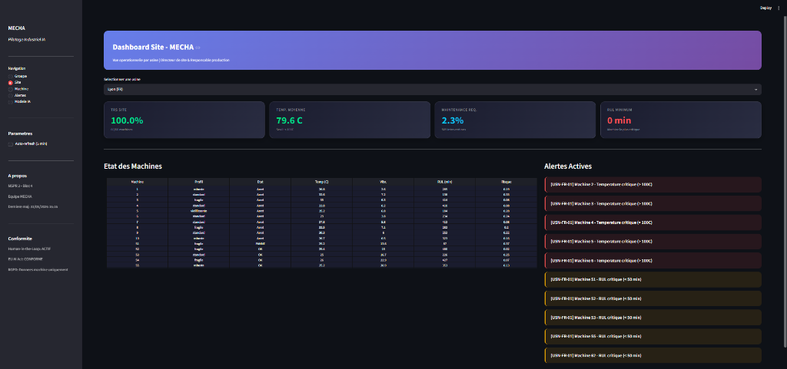
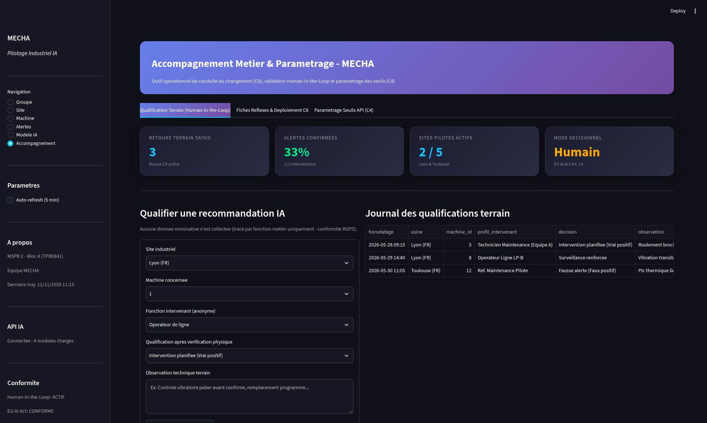

# Guide Utilisateur Métier — MECHA Predict (C7)

> **Public cible** : Responsables de maintenance, responsables de production, techniciens d'atelier et chefs d'équipe des 5 usines MECHA (Lyon, Toulouse, Nantes, Barcelone, Madrid)  
> **Référence** : MSPR 2 — Bloc 4 RNCP35584 (`TPRE841`) | **Format** : Référentiel opérationnel métier (2 pages)

---

## 1. À quoi sert MECHA Predict ?

**MECHA Predict** est un outil d'aide à la décision qui anticipe les pannes sur vos **50 machines d'usinage et de découpe** à partir des capteurs IoT d'atelier (température, vibration, pression, humidité, énergie). Il poursuit trois objectifs concrets :
1. **Éviter les arrêts non planifiés** en détectant les dérives mécaniques ou thermiques avant la casse.
2. **Planifier les interventions au bon moment** grâce à l'estimation du temps restant avant défaillance (**RUL**, exprimé en **minutes**).
3. **Protéger la qualité client** (aéronautique & automobile) en repérant immédiatement les régimes anormaux susceptibles de générer des rebuts.

> **Règle d'or — Mode *Human-in-the-Loop* (Conformité EU AI Act)** : MECHA Predict émet uniquement des **recommandations**. Aucune machine n'est arrêtée automatiquement et aucun ordre de travail n'est imposé sans validation par un technicien ou responsable qualifié.

---

## 2. Prise en main des deux interfaces complémentaires

| Outil | Accès standard (Docker) | Public principal | Usage quotidien |
|-------|-------------------------|------------------|-----------------|
| **Application Métier Streamlit** | `http://localhost:8501` | Responsables site, techniciens maintenance, référents terrain | Diagnostic IA machine par machine, centre d'alertes filtrable, qualification terrain et réglage des seuils (**6 vues**) |
| **Supervision Temps Réel Grafana** | `http://localhost:3000` | Direction Générale, directeurs d'usine, pupitreurs atelier | Écrans muraux temps réel connectés à PostgreSQL (**3 tableaux de bord pré-configurés**) |

### 2.1 Les 6 vues de l'Application Métier Streamlit
Utilisez le menu latéral gauche **Navigation** pour basculer entre les vues :
1. **Groupe** : Vision consolidée des 5 usines FR/ES (parc total, machines actives/en panne, alertes IA détectées, comparatif inter-sites).
2. **Site** : Pilotage d'une usine choisie (état des 10 machines du site, jauges KPIs, liste priorisée des machines à contrôler).
3. **Machine** : Diagnostic complet d'un équipement (évolution historique des capteurs, probabilité IA de panne, **RUL en minutes**, score d'anomalie).
4. **Alertes** : Centre d'alertes multi-critères filtrable par **usine**, **type d'alerte** (*Température critique*, *RUL critique*, *Prédiction IA*, *Panne*) et **profil machine**.
5. **Modèle IA** : Transparence sur l'état des modèles chargés par l'API et leurs performances vérifiées (`F1 = 80,4 %` Random Forest, `81,1 %` XGBoost).
6. **Accompagnement** : Fiches réflexes par métier, **formulaire de qualification terrain** (*Vrai positif / Surveillance / Fausse alerte*) et **réglage à chaud des seuils d'alerte**.

### 2.2 Les 3 tableaux de bord Grafana (monitoring continu)
- **MECHA — Direction Générale** : disponibilité globale, comparaison France / Espagne, tendances macroscopiques.
- **MECHA — Responsable Usine** : suivi d'atelier par ligne (`LP-A`, `LP-B`, `LP-C`), températures et alertes actives du site.
- **MECHA — Technicien Maintenance** : courbes fines capteurs (température/vibration) et suivi des équipements les plus sollicités.

---

## 3. Comment interpréter les indicateurs et décider ?

### 3.1 Grille de lecture des scores IA et seuils métier

| Indicateur affiché | Niveau Vert (Nominal) | Niveau Orange (Vigilance) | Niveau Rouge (Action prioritaire) | Action métier recommandée |
|--------------------|-----------------------|---------------------------|-----------------------------------|---------------------------|
| **Probabilité IA de maintenance** | `< 30 %` (`low`) | `30 % – 60 %` (`medium`) / `60 % – 85 %` (`high`) | **`>= 85 %` (`critical`)** *(alerte active dès `50 %`)* | Contrôler physiquement la machine et préparer l'intervention préventive |
| **Temps restant estimé (RUL)** | `>= 300 min` (`safe`) | `50 – 300 min` (`moderate` / `soon`) | **`< 50 min` (`urgent`)** | Planifier l'arrêt préventif avant la fin du créneau estimé (±27 min de marge moyenne) |
| **Score d'anomalie capteur** | `>= 0` (`low`) | `-0,30 à 0` (`medium` / `high`) | **`< -0,30` (`critical`)** | Vérifier un comportement atypique inédit (capteur encrassé, outil usé, lot matière dur) |
| **Seuils physiques directs** | Temp. `<= 85 °C`, Vibr. `<= 55 mm/s` | Temp. `85 – 100 °C`, Vibr. `55 – 70 mm/s` | **Temp. `> 100 °C` ou Vibr. `> 70 mm/s`** | Inspection immédiate du refroidissement, de la lubrification ou du palier de broche |

### 3.2 Procédure opérationnelle en 3 étapes devant une alerte
1. **Vérifier le contexte dans la vue *Machine*** : regarder si la hausse est progressive (vraie dégradation mécanique/thermique) ou isolée sur une minute (transitoire de nettoyage ou changement de série).
2. **Croiser avec le terrain** : contrôler visuellement/auditivement l'équipement et décider du créneau d'intervention avec le responsable de production (hors pic de charge critique si le RUL > 150 min le permet).
3. **Qualifier l'alerte dans la vue *Accompagnement*** : enregistrer en 15 secondes votre verdict (*Intervention planifiée*, *Surveillance renforcée* ou *Fausse alerte*). Aucune donnée nominative n'est enregistrée (respect strict du RGPD).

---

## 4. Conditions d'usage, limites connues et support

1. **Précision et marge d'incertitude** : le modèle détecte **90 % des besoins de maintenance** sur le périmètre qualifié (`F1 = 80,4 %`), et l'estimation RUL comporte une erreur moyenne de **±27 minutes** sur une fenêtre de 0 à 500 minutes. Ne jamais attendre `RUL = 0 min` pour intervenir sur une pièce aéronautique critique.
2. **Pannes soudaines non progressives** : une rupture brutale d'alimentation électrique ou une casse accidentelle d'outil sans échauffement ni vibration préalable (~0,1 % des cas) ne peut pas être anticipée par les capteurs thermiques/vibratoires.
3. **Capteur défaillant ou API hors ligne** : l'état de connexion de l'API IA est affiché en permanence dans le bandeau gauche (*API IA : Connectée : 4 modèles chargés*). En cas d'indisponibilité réseau, se référer aux seuils physiques Grafana et aux rondes standards.
4. **Support & ajustement des seuils** : si un atelier génère trop d'alertes lors d'un usinage spécifique, le responsable maintenance peut ajuster les seuils directement dans l'onglet **Accompagnement → Paramétrage Seuils API** ou contacter le référent pilote IA du site.
